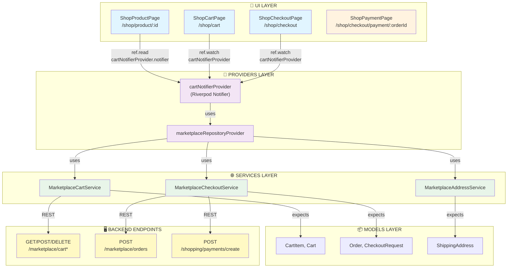
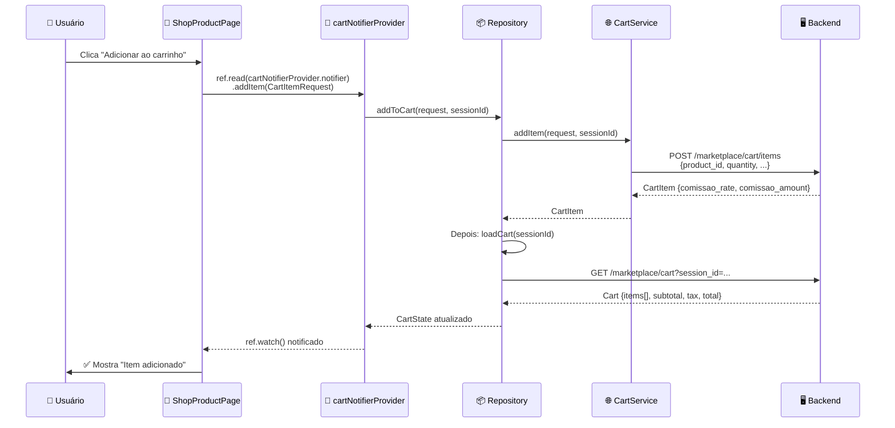
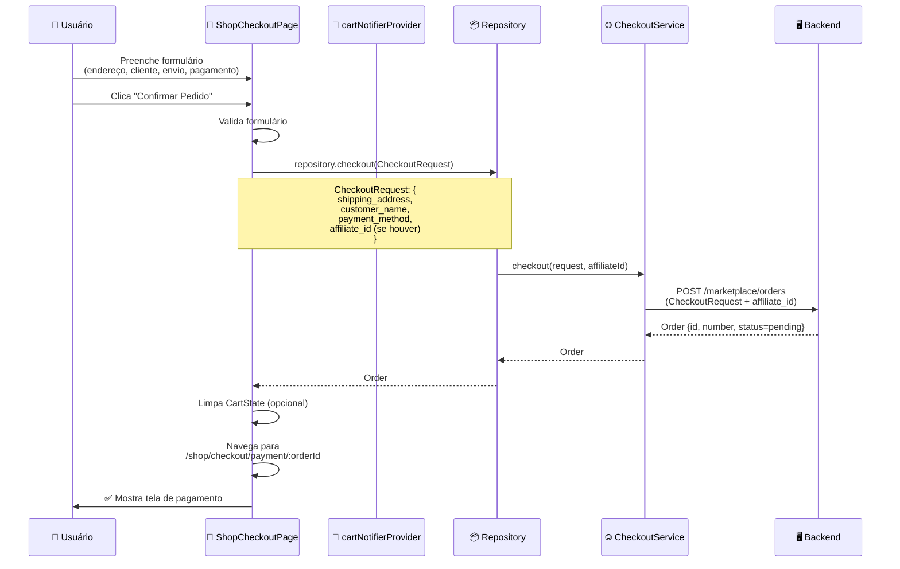
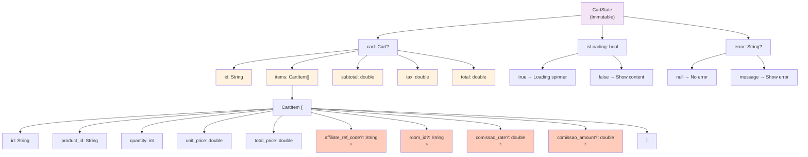
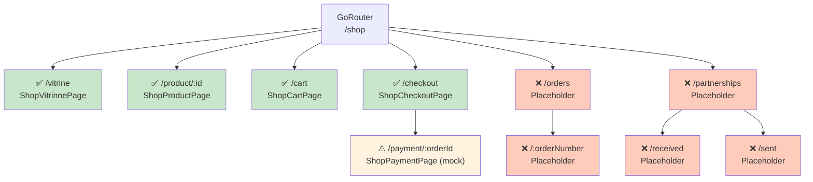
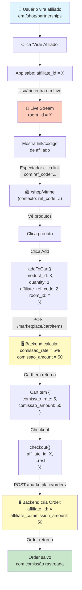
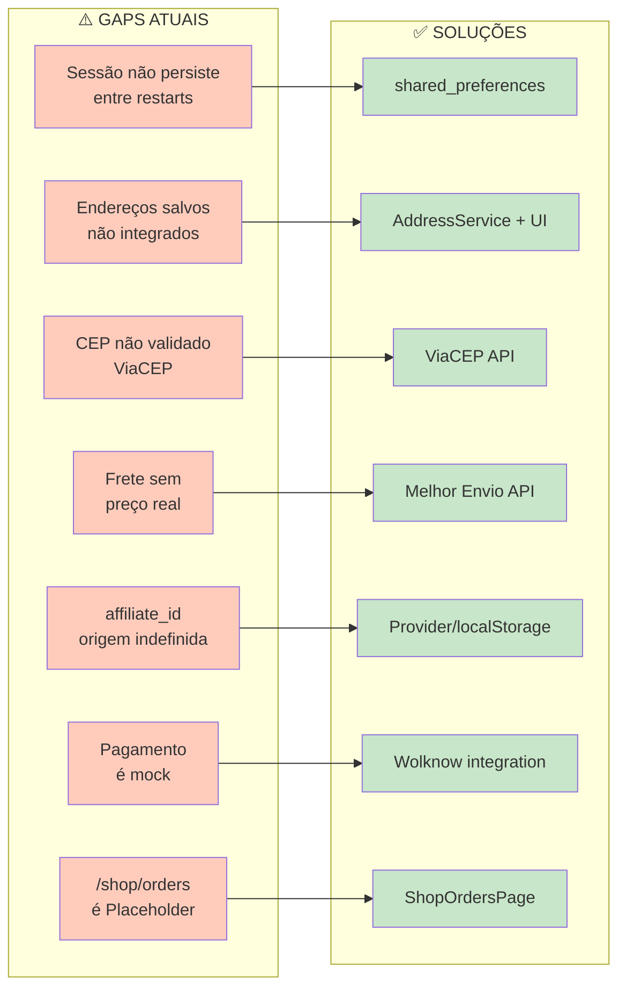
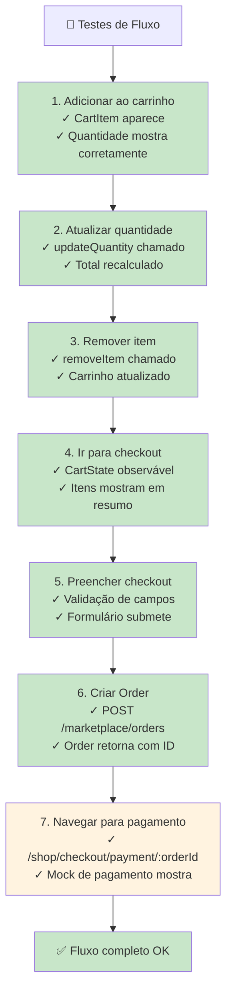

# 🎯 FLUXO VISUAL: Carrinho + Checkout

## 1. ARQUITETURA DE CAMADAS



---

## 2. FLUXO DE DADOS: Add to Cart



---

## 3. FLUXO DE DADOS: Checkout



---

## 4. FLUXO COMPLETO: Product → Cart → Checkout

```mermaid
graph TD
    Start[("👤 Usuário<br/>em /shop/vitrine")] -->|Clica produto| ProductPage["🎨 ShopProductPage<br/>/shop/product/:id"]
    
    ProductPage -->|Mostra: imagem,<br/>preço, descrição| ProductUI["📱 UI do Produto"]
    
    ProductUI -->|Usuário clica<br/>Adicionar| AddCart["🛒 addToCart<br/>(product_id, quantity)"]
    
    AddCart -->|ref.read<br/>cartNotifierProvider| CartNotifier["🔄 CartNotifier<br/>.addItem()"]
    
    CartNotifier -->|POST /marketplace/cart/items| BackendCart["🖥️ Backend Cart API<br/>POST /marketplace/cart/items"]
    
    BackendCart -->|Retorna CartItem<br/>com comissões| CartItem["📦 CartItem<br/>{comissao_rate, amount}"]
    
    CartItem -->|Depois loadCart| GetCart["🖥️ GET /marketplace/cart<br/>sessionId"]
    
    GetCart -->|Retorna| Cart["📦 Cart<br/>{items[], subtotal, tax}"]
    
    Cart -->|Atualiza estado| CartState["🔄 CartState<br/>isLoading=false"]
    
    CartState -->|ref.watch() notifica| CartPage["🎨 ShopCartPage<br/>/shop/cart"]
    
    CartPage -->|Mostra: itens,<br/>quantidades, preço| CartUI["📱 UI do Carrinho"]
    
    CartUI -->|Usuário clica<br/>Checkout| CheckoutNav["➡️ Navigate to<br/>/shop/checkout"]
    
    CheckoutNav -->|GoRouter| CheckoutPage["🎨 ShopCheckoutPage<br/>/shop/checkout"]
    
    CheckoutPage -->|Mostra: endereço,<br/>cliente, envio,<br/>pagamento| CheckoutForm["📋 Formulário"]
    
    CheckoutForm -->|Usuário preenche<br/>e clica Confirmar| ValidateForm["✓ Valida formulário"]
    
    ValidateForm -->|Cria| CheckoutRequest["📦 CheckoutRequest<br/>{address, customer,<br/>method, affiliate_id}"]
    
    CheckoutRequest -->|repository<br/>.checkout()| Checkout["🔄 Checkout<br/>via Repository"]
    
    Checkout -->|POST /marketplace/orders| BackendCheckout["🖥️ Backend Order API<br/>POST /marketplace/orders"]
    
    BackendCheckout -->|Cria Order<br/>status=pending| Order["📦 Order<br/>{id, number, status,<br/>affiliate_commission}"]
    
    Order -->|Retorna| OrderCreated["✅ Order criada"]
    
    OrderCreated -->|Navigate to| PaymentPage["🎨 ShopPaymentPage<br/>/shop/checkout/payment/:orderId"]
    
    PaymentPage -->|Mostra: PIX mock<br/>QR code placeholder| PaymentUI["⚠️ Mock Payment UI"]
    
    PaymentUI -->|Botão: Meus Pedidos| OrdersList["❌ /shop/orders<br/>Placeholder"]
    
    style Start fill:#ffebee
    style ProductPage fill:#e1f5ff
    style CartNotifier fill:#f3e5f5
    style BackendCart fill:#fff9c4
    style CartPage fill:#e1f5ff
    style CheckoutPage fill:#e1f5ff
    style BackendCheckout fill:#fff9c4
    style PaymentPage fill:#fff3e0
    style OrdersList fill:#ffccbc
```

---

## 5. ESTADO DO CARRINHO (CartState)



---

## 6. SESSÃO ANÔNIMA (CartSession)

```mermaid
graph LR
    A["CartSession<br/>(Static Singleton)"] --> B["_sessionId: String?"]
    
    B -->|null| C["generate()"]
    C -->|now.microsecondsSinceEpoch<br/>+ hashCode| D["'anon_1a2b3c4d'"]
    D -->|return| E["CartSession.id"]
    
    B -->|cached| E
    
    E -->|usado em| F["getCart(sessionId)"]
    E -->|usado em| G["addToCart(sessionId)"]
    E -->|usado em| H["updateCart(sessionId)"]
    
    Note over A,B: ⚠️ Em memória apenas<br/>Perde entre restarts<br/>TODO: shared_preferences
    
    style A fill:#e8f5e9
    style B fill:#fff3e0
    style C fill:#f3e5f5
    style D fill:#c8e6c9
    style E fill:#c8e6c9
    style F fill:#ffeb3b
    style G fill:#ffeb3b
    style H fill:#ffeb3b
```

---

## 7. ROTAS REGISTRADAS



---

## 8. INTEGRAÇÃO DE AFILIADOS



---

## 9. GAPS E SOLUÇÕES



---

## 10. CHECKLIST DE TESTES



---

## LEGENDA

| Símbolo | Significado |
|---------|------------|
| ✅ | Implementado e funcional |
| ⚠️ | Implementado mas com gaps/mock |
| ❌ | Não implementado |
| 🎨 | UI Component |
| 🔄 | Provider/State Management |
| 🌐 | Service/API |
| 📦 | Model/Data |
| 🖥️ | Backend Endpoint |
| ⭐ | Relacionado a afiliados |

