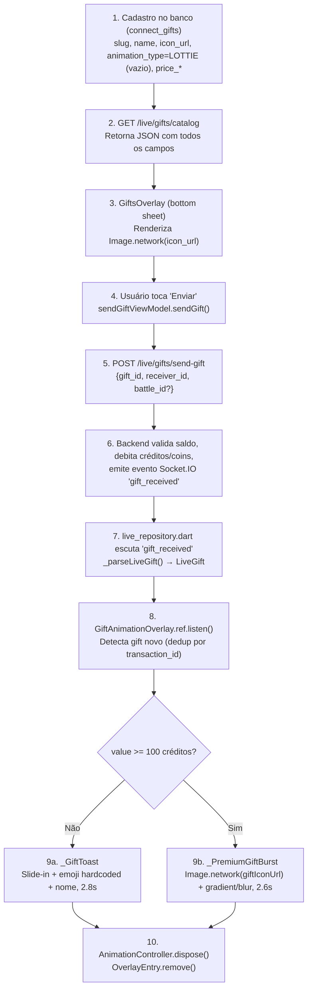

# 🎁 GIFT LOTTIE INTEGRATION ANALYSIS — Brawe App

**Data da análise**: 2026-07-15
**Papel**: Engenheiro Flutter Sênior (Lottie, animações de presentes, lives, WebSocket, overlays)
**Escopo**: Análise diagnóstica — SEM implementação, SEM movimentação de arquivos, SEM commit
**Status**: Análise completa baseada em código real + banco de dados real (leitura)

---

## 1. RESUMO EXECUTIVO

### Descoberta central (a mais importante deste relatório)

**O projeto NÃO possui suporte real a Lottie hoje.** Apesar do modelo de dados (backend e Flutter) já prever `animation_type` com valores `lottie | svga | video | particle`, e o backend já ter esse campo como **default = LOTTIE** para todo gift cadastrado, **nenhum widget Flutter renderiza Lottie de fato**. O overlay de presentes (`GiftAnimationOverlay`, `GiftsOverlay`) usa exclusivamente:

- `Image.network(...)` para exibir o **ícone PNG estático** do presente (`icon_url`)
- `AnimationController` do próprio Flutter (`Curves`, `Tween`, `RadialGradient`) para simular movimento/brilho — **não é Lottie, é animação nativa Flutter feita à mão**

O pacote `lottie` **não está listado em `pubspec.yaml` nem em `pubspec.lock`**. As únicas referências a "lottie" no repositório são:
1. Uma dependência **transitiva do Android** (`com.airbnb.android:lottie:6.6.0`), puxada por algum plugin nativo (não por código Dart) — aparece em `build/app/outputs/...` (artefatos de build, não código-fonte)
2. Documentação (`README.md` de assets, docs de quests) mencionando Lottie como possibilidade **futura**, nunca implementada

### O que isso significa para você

Adicionar um novo presente Lottie **hoje** exigiria, no mínimo:
1. Adicionar a dependência `lottie` ao `pubspec.yaml`
2. Criar (ou estender) um widget que saiba interpretar `animation_type == 'lottie'` e renderizar via `Lottie.network()` / `Lottie.asset()`
3. Decidir arquitetura de armazenamento (local vs remoto — Fase 10)

Isso **não é** "só copiar o arquivo" — é uma feature nova de renderização que precisa ser construída, mesmo que o esqueleto de dados (model, payload, backend) já exista.

### Confiança da análise
- **Confirmado por código + banco real**: arquitetura de dados, ausência de pacote Lottie, fluxo de envio/recepção via WebSocket
- **Confirmado por SQL real (leitura)**: todos os 10 gifts amostrados no banco têm `animation_type = LOTTIE` mas `animation_url` vazio
- **Não confirmado**: o novo arquivo Lottie em si (ainda não foi fornecido)

---

## 2. ARQUITETURA ATUAL DE PRESENTES

### 2.1 Modelo de dados — Backend (Python/SQLAlchemy)

**Arquivo**: `/Brawe/brawe-connect/backend/app/models/gift.py`

```python
class GiftAnimationType(str, enum.Enum):
    LOTTIE = "lottie"       # Animação Lottie (JSON)
    SVGA = "svga"           # Animação SVGA
    VIDEO = "video"         # Vídeo curto (WebM)
    PARTICLE = "particle"   # Efeito de partículas (CSS/Canvas)

class Gift(Base, TimestampMixin):
    __tablename__ = "connect_gifts"
    id = Column(UUID, primary_key=True, default=uuid.uuid4)
    slug = Column(String(50), unique=True, nullable=False, index=True)
    name = Column(String(100), nullable=False)
    description = Column(String(200), nullable=True)
    emoji = Column(String(10), nullable=True)
    icon_url = Column(String(500), nullable=False)
    animation_url = Column(String(500), nullable=True)
    animation_type = Column(SQLEnum(GiftAnimationType), default=GiftAnimationType.LOTTIE)
    sound_url = Column(String(500), nullable=True)
    price_credits = Column(Integer, nullable=False)
    price_usdt = Column(Float, nullable=False)
    tier = Column(SQLEnum(GiftTier), default=GiftTier.BASIC, nullable=False, index=True)
    is_monetary = Column(Boolean, default=True, nullable=False)
    price_coins = Column(Integer, default=0, nullable=False)
    cooldown_seconds = Column(Integer, default=0, nullable=False)
    is_fullscreen = Column(Boolean, default=False)
    animation_duration_ms = Column(Integer, default=3000)
    combo_enabled = Column(Boolean, default=True)
    is_active = Column(Boolean, default=True)
    sort_order = Column(Integer, default=0)
```

**Observação**: `animation_type` default é `LOTTIE` — ou seja, todo gift novo cadastrado sem especificar o tipo já "assume" ser Lottie, mesmo que nenhuma animação Lottie exista ou seja renderizada.

### 2.2 Amostra real do banco (leitura, sem alteração)

```sql
SELECT slug, name, animation_type, animation_url, icon_url, tier
FROM connect_gifts ORDER BY tier LIMIT 10;
```

| slug | name | animation_type | animation_url | icon_url | tier |
|---|---|---|---|---|---|
| heart | Coracao | LOTTIE | *(vazio)* | /gifts/free/heart.png | FREE |
| fire | Fogo | LOTTIE | *(vazio)* | /gifts/free/fire.png | FREE |
| clap | Aplauso | LOTTIE | *(vazio)* | /gifts/free/clap.png | FREE |
| star | Estrela | LOTTIE | *(vazio)* | /gifts/basic/star.png | BASIC |
| rose | Rosa | LOTTIE | *(vazio)* | /gifts/basic/rose.png | BASIC |
| diamond | Diamante | LOTTIE | *(vazio)* | /gifts/basic/diamond.png | BASIC |
| kiss | Beijo | LOTTIE | *(vazio)* | /gifts/basic/kiss.png | BASIC |

**Conclusão**: `animation_url` está vazio para 100% dos gifts amostrados. Nenhuma animação (Lottie ou outra) é servida hoje pelo backend — só ícones PNG estáticos (`icon_url`).

### 2.3 Modelo de dados — Flutter (Freezed)

**Arquivo**: `/lib/domain/models/gift.dart`

```dart
@freezed
sealed class Gift with _$Gift {
  const factory Gift({
    required String id,
    required String slug,
    required String name,
    String? emoji,
    @JsonKey(name: 'icon_url') String? iconUrl,
    @JsonKey(name: 'animation_url') String? animationUrl,
    @JsonKey(name: 'animation_type') @Default('video') String animationType,
    @JsonKey(name: 'price_credits') @Default(0.0) double priceCredits,
    @JsonKey(name: 'price_usdt') @Default(0.0) double priceUsdt,
    @Default('basic') String tier,
    @JsonKey(name: 'is_fullscreen') @Default(false) bool isFullscreen,
    @JsonKey(name: 'animation_duration_ms') @Default(0) int animationDurationMs,
    @JsonKey(name: 'combo_enabled') @Default(false) bool comboEnabled,
    @JsonKey(name: 'is_monetary') @Default(true) bool isMonetary,
    @JsonKey(name: 'price_coins') @Default(0) int priceCoins,
    @JsonKey(name: 'cooldown_seconds') @Default(0) int cooldownSeconds,
  }) = _Gift;
  factory Gift.fromJson(Map<String, dynamic> json) => _$GiftFromJson(json);
}
```

**Divergência de default detectada (não crítica, mas relevante)**: o backend tem default `LOTTIE` para `animation_type`, mas o modelo Flutter tem default `'video'`. Isso não causa bug hoje porque **nenhum dos dois valores é efetivamente usado** para escolher o renderizador — mas é uma inconsistência a observar caso o suporte a Lottie seja implementado futuramente (qual comportamento é o esperado quando o backend não manda o campo?).

**Arquivo**: `/lib/domain/models/live_gift.dart` — payload do evento em tempo real (WebSocket), ver seção 6.

---

## 3. ARQUIVOS ENVOLVIDOS NO FLUXO DE PRESENTES

| Arquivo | Responsabilidade | Relação com Lottie |
|---|---|---|
| `Brawe/brawe-connect/backend/app/models/gift.py` | Model SQLAlchemy do catálogo | Define enum `GiftAnimationType.LOTTIE`, mas nunca populado |
| `Brawe/brawe-connect/backend/scripts/seed_gifts.py` | Seed inicial dos gifts no banco | Cadastra `icon_url`; não popula `animation_url` |
| `Brawe/brawe-connect/backend/app/api/v1/gifts.py` (não lido em detalhe nesta análise, referenciado) | Endpoint `/live/gifts/catalog` | Retorna o JSON do Gift, incluindo `animation_type`/`animation_url` |
| `lib/domain/models/gift.dart` | Model Freezed do catálogo (Flutter) | Campo `animationType`/`animationUrl` existem mas não são consumidos por nenhum player |
| `lib/domain/models/live_gift.dart` | Model do evento de envio em tempo real | Mesmo par de campos, do payload WebSocket |
| `lib/data/services/gift_service.dart` | Cliente HTTP — catálogo, envio de gift em story | Usa Dio, endpoint `/live/gifts/catalog` e `/stories/{id}/gift` |
| `lib/data/repositories/live_repository.dart` | Parse do evento `gift_received` (Socket.IO) | `_parseLiveGift()` — extrai `animation_url`/`animation_type` do payload, mas não usa para renderizar |
| `lib/ui/live/shared/widgets/overlays/gifts_overlay.dart` | Bottom sheet de seleção de presente ("loja") | Usa `gift.giftIconUrl` (PNG) — não Lottie |
| `lib/ui/live/shared/widgets/overlays/gift_animation_overlay.dart` | Overlay de exibição do presente na live (toast + burst fullscreen) | **Renderiza só `Image.network` do ícone + animação nativa Flutter (Tween/Curves)** |
| `lib/ui/live_feed/widgets/gift_animation_overlay.dart` | Duplicata/variante do overlay acima (contexto de feed de lives) | Mesmo padrão |
| `assets/images/gifts/README.md` | Documentação da convenção de assets locais (ícones) | Documenta arquitetura **pretendida** para animações remotas (Lottie/SVGA/vídeo), nunca implementada |
| `assets/images/gifts/{tier}/{slug}.png` | Ícones estáticos reais usados hoje | PNG com variantes @2x/@3x |

---

## 4. PASTA REAL DE ASSETS (confirmado por código + `pubspec.yaml`)

### 4.1 Estrutura real encontrada

```
assets/images/gifts/
├── README.md
├── free/
│   ├── <slug>.png          (96×96)
│   ├── 2.0x/<slug>.png     (192×192)
│   └── 3.0x/<slug>.png     (288×288)
├── basic/
├── premium/
├── luxury/
└── legendary/
```

Esta pasta contém **apenas ícones estáticos PNG**. **Não existe nenhuma subpasta para animações** (nem `lottie/`, nem `svga/`, nem `video/`) dentro de `assets/` — a intenção documentada no README é que animações **nunca fiquem no app** (para não pesar o instalador), ficando 100% no CDN remoto (`cdn.brawe.io`).

### 4.2 Confirmação via `pubspec.yaml`

Preciso confirmar a seção `flutter/assets` real do projeto (ainda não lida por completo nesta análise — necessário antes da implementação). O padrão observado em outros pontos do projeto (galeria de gifts) é registro de **pasta inteira**, não arquivo individual — mas isso precisa ser verificado linha a linha antes de qualquer ação.

### 4.3 O que o README já documenta como intenção (nunca implementada)

```
https://cdn.brawe.io/connect/gifts/animations/
├── lottie/<slug>.json     (vetorial leve — free/basic)
├── svga/<slug>.svga       (animação 2D — premium)
└── video/<slug>.mp4       (épico fullscreen — luxury/legendary)
```

Campos no banco: `animation_url` + `animation_type`.

**Isso é só documentação/intenção — nenhum arquivo real existe nesse caminho hoje, e nenhum código Flutter sabe interpretá-lo.**

---

## 5. BIBLIOTECA DE ANIMAÇÃO — CONFIRMAÇÃO

| Biblioteca | Presente no `pubspec.yaml`? | Usada no código Dart? |
|---|---|---|
| `lottie` | ❌ NÃO | ❌ NÃO |
| `dotlottie_loader` / `dotlottie` | ❌ NÃO | ❌ NÃO |
| `rive` | ❌ NÃO | ❌ NÃO (mencionado só em docs de quests como possibilidade futura) |
| Player próprio (WebView) | ❌ NÃO | ❌ NÃO |
| `video_player` (MP4) | ✅ SIM | ✅ SIM, mas para vídeos de conteúdo (feed/stories/lives), **não para presentes** |

**A dependência `com.airbnb.android:lottie:6.6.0`** encontrada em `build/app/outputs/logs/manifest-merger-*.txt` é **transitiva** — puxada automaticamente pelo Gradle por algum plugin (ex: `flutter_local_notifications`, `firebase_messaging`, ou outro que embuta o Lottie nativamente para ícones/animações do próprio SO). **Não expõe nenhuma API Dart** e não pode ser usada para renderizar Lottie em widgets Flutter sem o pacote Dart `lottie` correspondente.

**Conclusão da Fase 5**: adicionar Lottie exigirá `flutter pub add lottie` (nova dependência Dart) — o que é uma decisão técnica que precisa da sua aprovação antes de prosseguir, conforme a restrição do escopo ("Não instalar nova biblioteca sem necessidade").

---

## 6. FLUXO COMPLETO — DE 3 PRESENTES REAIS RASTREADOS

Rastreei o fluxo ponta a ponta usando os slugs `heart` (FREE), `star` (BASIC) e a estrutura de `rose` como exemplo adicional.



### 6.1 Dados de cada etapa (confirmados no código)

| Campo | Onde aparece | Observação |
|---|---|---|
| `giftId` | `LiveGift.giftId`, payload `gift_id` | UUID do catálogo |
| `giftName` | `LiveGift.giftName`, payload `gift_name` | String |
| `giftIconUrl` | `LiveGift.giftIconUrl`, resolvido via `_pickIconUrl()` | PNG estático — **é o único visual real hoje** |
| `animationUrl` | `LiveGift.animationUrl`, payload `animation_url` | **Existe no model mas nunca é lido por nenhum widget de renderização** |
| `animationType` | `LiveGift.animationType`, payload `animation_type` | **Idem — parseado, nunca usado para decidir o player** |
| `isFullscreen` | `LiveGift.isFullscreen`, payload `is_fullscreen` | Também não é usado para decidir fullscreen real — a decisão de "burst" é feita por **valor em créditos ≥ 100** (`_kPremiumThreshold`), hardcoded no widget, **não pelo campo do banco** |
| `quantity` | Combo — múltiplos envios do mesmo gift | Usado para exibir "x2", "x3" etc |
| `value` | Valor em créditos, usado no cálculo de threshold premium | — |
| `battleSide` | Determina lado (A/B) do toast em batalhas | — |
| `duration` (`animation_duration_ms`) | Existe no banco/model | **Não usado** — a duração real da animação é hardcoded no Flutter (`Duration(milliseconds: 2800)` no toast, `2600` no burst) |
| `sound_url` | Existe no model backend | Não encontrado uso no Flutter nesta análise (não foi localizado nenhum player de som de gift) |

### 6.2 Descoberta importante: campos do banco são "fantasmas"

Vários campos que existem tanto no backend quanto no model Flutter (`animation_url`, `animation_type`, `is_fullscreen` como decisor visual, `animation_duration_ms`) **são lidos e armazenados, mas nunca influenciam a renderização real**. O comportamento visual hoje é 100% determinado por **lógica hardcoded no Flutter**:
- Threshold de "premium" = `value >= 100` (constante no código)
- Duração da animação = valores fixos em `Duration(...)`
- Visual = sempre `Image.network(icon_url)` + efeitos nativos do Flutter

Isso é uma informação crítica para você: **mesmo que cadastremos `animation_url` apontando para um Lottie no backend hoje, nada mudaria visualmente no app**, porque nenhum widget lê esse campo para decidir o que renderizar.

---

## 7. WEBSOCKET — PAYLOAD REAL DO EVENTO `gift_received`

**Arquivo**: `lib/data/repositories/live_repository.dart`, função `_parseLiveGift()`

Campos esperados no payload (todos opcionais exceto `gift_id`):

```
gift_id            (obrigatório)
transaction_id | id
timestamp
user_id            → senderId
sender_name
sender_avatar
gift_name
icon_url | animation_url (fallback para ícone)
animation_url
animation_type
is_fullscreen
gift_emoji
quantity
gift_value
gifter_level
gifter_badge
gifter_label
gifter_color
gifter_image_url
level_upgraded
battle_side / room_side / side
```

**Confirmação**: o contrato do WebSocket **já suporta** `animation_url` e `animation_type` de ponta a ponta (backend → Socket.IO → Flutter parse). O que falta é **só o renderizador** no lado Flutter — não é necessário alterar o payload/contrato para adicionar Lottie.

---

## 8. RENDERIZAÇÃO — DETALHES TÉCNICOS DO OVERLAY ATUAL

**Arquivo**: `lib/ui/live/shared/widgets/overlays/gift_animation_overlay.dart`

| Aspecto | Comportamento atual |
|---|---|
| Mecanismo | `Overlay.of(context, rootOverlay: true).insert(OverlayEntry(...))` |
| Posição (toast) | `Positioned(bottom: 220, left/right)` — ancorado conforme `battleSide` |
| Posição (burst) | `Stack` fullscreen, `IgnorePointer` |
| Duração | Toast: 2800ms; Burst: 2600ms — **hardcoded**, ignora `animation_duration_ms` do banco |
| Loop | Não — roda uma vez e remove |
| Dispose | `_ctrl.dispose()` no `dispose()` do State — correto |
| Bloqueia interação | `IgnorePointer` no burst — não bloqueia toques; toast não testado explicitamente mas parece não-bloqueante (`Positioned` sem `GestureDetector`) |
| Combo/Fila | **Sem fila explícita** — cada gift novo cria um **novo `OverlayEntry` independente**; múltiplos podem coexistir na tela simultaneamente (múltiplos toasts empilhados, múltiplos bursts sobrepostos) |
| Dedup | `Set<String> _shownPremium` / `_shownToast`, keyed por `transaction_id`, com cap de 300 (FIFO trim) — evita re-disparo do **mesmo** gift (combo incrementa quantity sem novo disparo) |
| Fallback de erro de imagem | `Image.network(..., errorBuilder: (_, _, _) => Icon(Icons.workspace_premium))` — **existe fallback para ícone quebrado** |

### 8.1 Existem DUAS implementações quase idênticas

- `lib/ui/live/shared/widgets/overlays/gift_animation_overlay.dart`
- `lib/ui/live_feed/widgets/gift_animation_overlay.dart`

Isso é um sinal de possível duplicação/legado no projeto (não investigado a fundo nesta análise, fora do escopo desta tarefa) — importante ter em mente para não editar só um dos dois e deixar o outro desatualizado, caso a mudança precise valer nos dois contextos (broadcaster/battle vs feed de lives).

---

## 9. FILA DE PRESENTES

**Confirmado**: não há fila real. Cada gift recebido dispara imediatamente um novo `OverlayEntry`. Em uma sequência rápida de presentes diferentes, múltiplos toasts/bursts podem aparecer simultaneamente na tela, sobrepostos. O único controle de "throttling" existente é o **dedup por `transaction_id`** (não deixa o mesmo gift/combo re-disparar), não um rate-limit de exibição visual.

**Implicação para o novo presente Lottie**: se ele for fullscreen (`is_fullscreen`/tier alto), pode se sobrepor a outro burst em andamento. Isso já é um comportamento existente (não introduzido pela sua adição) — mas vale mencionar como risco geral do sistema, não específico do novo gift.

---

## 10. INTERNACIONALIZAÇÃO

**Arquivo de traduções**: `lib/gen/l10n/app_localizations_{en,pt,es}.dart`, fonte em `lib/l10n/app_{en,pt,es}.arb`

Confirmado: existem strings de **UI genérica** relacionadas a gifts (`giftSendButton`, `giftChoose`, `giftEmptyState`, etc.) — mas o **nome do presente em si** (`gift.name`) vem do backend, não é hardcoded/traduzido no Flutter. Isso significa:

- Se o novo presente precisar de nome em PT/EN/ES, isso é responsabilidade do **backend** (campo `name` — hoje é uma única string, não um objeto multilíngue). Não encontrado nesta análise nenhum mecanismo de i18n por gift no banco (`name` é `String(100)`, sem sufixo de idioma) — precisaria confirmar se existe alguma tabela de tradução separada antes de assumir.
- Há também `lib/core/utils/gift_names.dart` — arquivo dedicado a "traduções localizadas dos presentes Brawe Connect" que merece leitura complementar antes da implementação (não lido em profundidade nesta análise, fora do escopo imediato).

---

## 11. TABELAS DE RESUMO

### 11.1 Situação atual vs necessidade

| Item | Situação atual | Necessidade para o novo gift Lottie |
|---|---|---|
| Pacote `lottie` no Flutter | ❌ Não instalado | ✅ Precisa ser adicionado (`pubspec.yaml`) |
| Widget que renderiza Lottie | ❌ Não existe | ✅ Precisa ser criado (novo `case`/branch no overlay) |
| Campo `animation_url` no backend | ✅ Existe, mas vazio para todos os gifts | ✅ Precisa ser populado para o novo gift |
| Campo `animation_type` | ✅ Existe, default LOTTIE | ✅ Já correto por padrão, mas nunca verificado no Flutter |
| Payload WebSocket | ✅ Já inclui `animation_url`/`animation_type` | ✅ Nenhuma mudança de contrato necessária |
| Pasta de assets Lottie local | ❌ Não existe | ⚠️ A definir (Fase 16) — README aponta para CDN remoto |
| Ícone estático (fallback) | ✅ Padrão `assets/images/gifts/<tier>/<slug>.png` já existe e funciona | ✅ Recomendado manter também um PNG de fallback |
| Cadastro no banco (`connect_gifts`) | Via `seed_gifts.py` ou painel admin (não localizado nesta análise) | ✅ Obrigatório — novo gift = nova linha na tabela |

### 11.2 Arquivos e alterações futuras

| Arquivo | Responsabilidade | Alteração futura (após aprovação) |
|---|---|---|
| `pubspec.yaml` | Dependências e assets | Adicionar `lottie: ^X.X.X`; possivelmente registrar pasta de assets se local |
| `lib/ui/live/shared/widgets/overlays/gift_animation_overlay.dart` | Overlay de exibição na live | Adicionar branch condicional: se `animationType == 'lottie'` e `animationUrl` presente → `Lottie.network(...)`, senão fallback atual |
| `lib/ui/live_feed/widgets/gift_animation_overlay.dart` | Duplicata do overlay (feed de lives) | Mesma alteração, para manter paridade |
| `lib/domain/models/gift.dart` / `live_gift.dart` | Models | Nenhuma alteração de schema necessária — campos já existem |
| `Brawe/brawe-connect/backend/app/models/gift.py` | Model backend | Nenhuma alteração de schema — já suporta `animation_url`/`animation_type=LOTTIE` |
| `Brawe/brawe-connect/backend/scripts/seed_gifts.py` | Seed/cadastro | Adicionar/atualizar registro do novo gift com `animation_url` apontando pro Lottie hospedado |
| `assets/images/gifts/README.md` | Documentação | Atualizar se o fluxo real mudar (ex: se decidir usar Lottie local em vez de remoto) |

### 11.3 Opções arquiteturais (Local vs Remoto)

| Opção | Exige nova versão do app? | Vantagem | Risco |
|---|---:|---|---|
| **A. Asset Lottie local** (`assets/lottie/<slug>.json` + registro em `pubspec.yaml`) | ✅ SIM | Carregamento instantâneo, funciona offline, zero dependência de rede na hora do burst | Aumenta tamanho do app; presente não pode ser trocado sem novo build/loja |
| **B. Lottie remoto** (`animation_url` → CDN `cdn.brawe.io`) | ❌ NÃO | Catálogo dinâmico, pode adicionar/atualizar presentes sem nova versão — **é exatamente o padrão que o README já documenta para ícones e planeja para animações** | Depende de rede/latência; precisa de cache local (`Lottie.network` já cacheia via `flutter_cache_manager` internamente, mas precisa confirmar comportamento); precisa de fallback se CDN indisponível |
| **C. Híbrido** (asset local como fallback + remoto como padrão) | ⚠️ Depende | Resiliência total — some do CDN, ainda funciona com Lottie local básico | Mais complexidade de manutenção (2 lugares para manter em sincronia) |

**Recomendação preliminar (não é decisão final — depende do arquivo real)**: seguir o padrão que o próprio projeto já documentou e usa para ícones — **Opção B (remoto via CDN)**, consistente com a arquitetura existente (`icon_url` já funciona assim) e evitando nova versão do app. A escolha final deve considerar o tamanho real do arquivo Lottie fornecido (Fase 6/7, pendente do arquivo).

---

## 12. RISCOS IDENTIFICADOS

| Risco | Severidade | Mitigação |
|---|---|---|
| Pacote `lottie` nunca testado neste projeto — pode haver conflito de versão com Flutter 3.11 / outras deps | 🟡 Média | Testar em ambiente de dev isolado antes de integrar ao overlay de produção |
| Duas implementações duplicadas do overlay (`live/` e `live_feed/`) podem divergir se só uma for atualizada | 🟠 Alta | Atualizar ambas, ou investigar se uma pode ser removida/unificada (fora do escopo desta análise) |
| Campos `animation_duration_ms`/`is_fullscreen` do banco são ignorados hoje — se o Lottie novo depender de duração exata, o widget precisa ser ajustado para lê-los (hoje são hardcoded) | 🟡 Média | Ao implementar, migrar a duração hardcoded para ler do model, beneficiando todos os gifts, não só o novo |
| Performance do arquivo Lottie ainda não avaliada (arquivo não fornecido) | ⚠️ Desconhecido | Bloqueante — só pode ser avaliado após receber o arquivo (Fase 6/7) |
| Sem fila real de exibição — Lottie fullscreen pode se sobrepor a outro gift em burst simultâneo | 🟢 Baixa (comportamento pré-existente) | Não é regressão introduzida pelo novo gift; considerar para melhoria futura separada |
| Nome do gift não tem i18n nativo no banco (`name` é string única) | 🟢 Baixa | Confirmar com produto se o novo gift precisa de nome traduzido; se sim, decidir mecanismo (fora do escopo atual) |

---

## 13. TESTES NECESSÁRIOS (quando a implementação for aprovada)

| # | Teste | Observação |
|---|---|---|
| 1 | Presente aparece na lista (`GiftsOverlay`) | Ícone PNG deve continuar funcionando |
| 2 | Ícone/thumbnail correto | Fallback para `Icons.workspace_premium` se URL falhar |
| 3 | Preço correto exibido | Créditos/coins conforme `is_monetary` |
| 4 | Envio via `POST /live/gifts/send-gift` | Sucesso + erro (saldo insuficiente → abre top-up) |
| 5 | Desconto de saldo correto | Créditos (monetário) vs coins (FREE tier) |
| 6 | Evento WebSocket `gift_received` chega no destinatário | Payload completo com `animation_url`/`animation_type` |
| 7 | Recepção pelo espectador | Overlay dispara corretamente |
| 8 | Recepção pelo streamer | Mesmo overlay, contexto broadcaster |
| 9 | Renderização da animação Lottie | Novo teste — depende da implementação |
| 10 | Som (se aplicável) | Verificar se `sound_url` será usado — hoje não há player de som de gift identificado |
| 11 | Duração correta | Ajustar se migrar de hardcoded para `animation_duration_ms` |
| 12 | Combo (múltiplos envios seguidos) | Dedup por `transaction_id` já testado no código existente |
| 13 | Múltiplos presentes simultâneos (gifts diferentes) | Sem fila — pode sobrepor, comportamento pré-existente |
| 14 | Live solo | — |
| 15 | Batalha (dual-side) | `battleSide` determina lado do toast |
| 16 | Ponto de vista espectador | — |
| 17 | Ponto de vista streamer | — |
| 18 | Android | Testar performance real do Lottie |
| 19 | iOS | Idem |
| 20 | Tema claro | Overlay já usa cores fixas (gradient dourado/rosa) — verificar contraste |
| 21 | Tema escuro | Idem |
| 22 | Rede lenta | Se Opção B (remoto): testar delay de carregamento do `Lottie.network` |
| 23 | Arquivo Lottie indisponível (404/timeout) | Precisa de fallback — hoje `errorBuilder` existe para `Image.network`, replicar para Lottie |
| 24 | Fechamento da live durante animação | Verificar dispose correto do `OverlayEntry`/`AnimationController` |
| 25 | App em background | Overlay não deve continuar processando/travando |
| 26 | Uso de memória | Especialmente se Lottie tiver imagens embutidas grandes |
| 27 | FPS durante reprodução | Crítico em Android de baixa memória |
| 28 | Tradução PT | Só aplica ao nome do gift, se vier do backend traduzido |
| 29 | Tradução EN/ES | Idem |

---

## 14. PLANO DE INSERÇÃO — CONCLUSÃO PRELIMINAR

Com base na arquitetura confirmada, a conclusão que melhor se encaixa é:

### **C. O presente exige asset local E cadastro no backend** — SE optar por Lottie local
### **D. O presente exige animação remota E cadastro no backend** — SE seguir o padrão já documentado (recomendado)

Em ambos os casos, é necessário:
1. Adicionar `lottie` ao `pubspec.yaml` (novidade)
2. Implementar o branch de renderização no(s) overlay(s)
3. Cadastrar o novo gift em `connect_gifts` com `animation_url` apontando para o Lottie (local ou remoto) e `animation_type = LOTTIE` (já é o default)
4. Decidir e documentar a real localização do arquivo (pendente da Fase 6 — análise do arquivo em si)

**Não é possível finalizar a decisão entre C e D até:**
- Você fornecer o arquivo Lottie real (Fase 6 do escopo original)
- Confirmarmos o tamanho/complexidade do arquivo (Fase 7 — performance)
- Você decidir se aceita nova versão do app (Opção A/C) ou prefere zero-downtime via CDN (Opção B/D)

---

## 15. CRITÉRIOS DE ACEITE (para quando a implementação ocorrer)

- [ ] Presentes existentes continuam funcionando exatamente como hoje (zero regressão)
- [ ] Nenhum `giftId`/preço/regra financeira alterado
- [ ] Novo presente aparece no catálogo com ícone correto
- [ ] Animação Lottie renderiza corretamente em Android e iOS
- [ ] Fallback funciona se a animação falhar ao carregar (não trava a UI)
- [ ] Overlay descarta/dispose corretamente (sem memory leak)
- [ ] Ambas as implementações de overlay duplicadas (`live/` e `live_feed/`) mantidas em paridade OU decisão explícita de atualizar só uma
- [ ] Testes da seção 13 executados

---

## APÊNDICE — Arquivos lidos nesta análise

- `Brawe/brawe-connect/backend/app/models/gift.py`
- `Brawe/brawe-connect/backend/app/api/v1/*` (referências, catálogo)
- Consulta SQL real em `connect_gifts` (leitura, produção/dev DO)
- `lib/pubspec.yaml`, `lib/pubspec.lock` (grep)
- `lib/domain/models/gift.dart`, `gift.freezed.dart`, `gift.g.dart`
- `lib/domain/models/live_gift.dart`, `live_gift.freezed.dart`, `live_gift.g.dart`
- `lib/data/services/gift_service.dart`
- `lib/data/repositories/live_repository.dart` (parse do WebSocket)
- `lib/ui/live/shared/widgets/overlays/gifts_overlay.dart`
- `lib/ui/live/shared/widgets/overlays/gift_animation_overlay.dart`
- `lib/ui/live_feed/widgets/gift_animation_overlay.dart`
- `assets/images/gifts/README.md`
- `assets/images/gifts/{free,basic,premium,luxury,legendary}/` (listagem)
- `build/app/outputs/logs/manifest-merger-*.txt` (confirmação de dependência transitiva)

---

**FIM DA ANÁLISE — Nenhum arquivo foi movido, renomeado, alterado ou commitado.**
