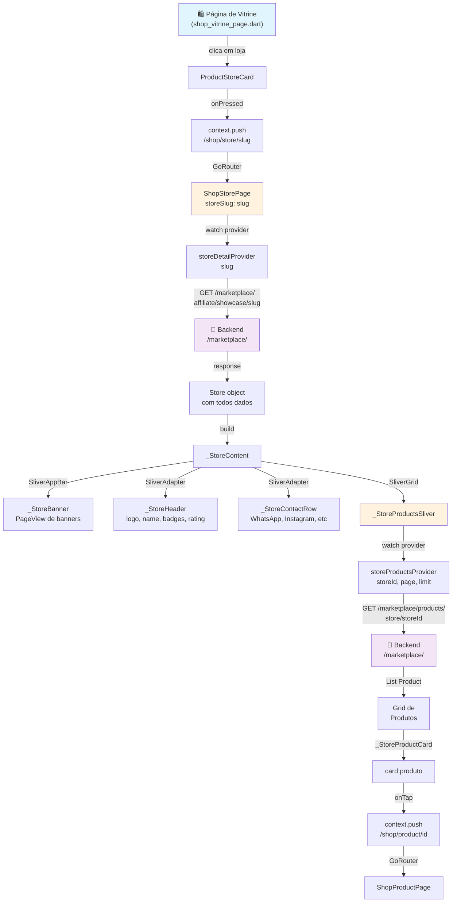

# 🏪 Análise Completa da Página de Loja (ShopStorePage)

## 📋 Resumo Executivo

A página de loja **está 100% completa e funcional**. Ela carrega e exibe informações da loja via slug, mostrando todos os dados relevantes (banner, logo, nome, rating, descrição, contatos) e um grid de produtos paginado.

---

## 1️⃣ PÁGINA DE LOJA - ESTADO ATUAL

### Arquivo Principal
```
📄 /lib/ui/shop/pages/shop_store_page.dart (completo)
```

### Estado: ✅ COMPLETO E FUNCIONAL

A página implementa:
- ✅ Carregamento de detalhes da loja por **slug**
- ✅ Banner rotativo (PageView) com múltiplas imagens
- ✅ Header com logo, nome, badges, rating
- ✅ Descrição expandível (Read More/Read Less)
- ✅ Categorias em chips horizontais
- ✅ Links de contato (WhatsApp, Instagram, Facebook, TikTok, Email)
- ✅ Grid responsivo de produtos (2-4 colunas)
- ✅ Estados de Loading/Error/Empty
- ✅ Fallback para banner quando não há imagens

### Componentes Internos

```
ShopStorePage (ConsumerWidget)
│
├─ [storeDetailProvider(slug)] → Carrega Store via API
│
└─ _StoreContent (quando dados carregam)
   │
   ├─ SliverAppBar com FlexibleSpaceBar
   │  └─ _StoreBanner (PageView de banners com indicadores)
   │
   ├─ SliverToBoxAdapter
   │  └─ _StoreHeader
   │     ├─ Logo (ClipOval)
   │     ├─ Nome + Badges (Premium 👑, BrawePass ✨)
   │     ├─ Rating (⭐) com contagem
   │     └─ Descrição expandível
   │
   ├─ SliverToBoxAdapter
   │  └─ _StoreContactRow
   │     ├─ WhatsApp icon
   │     ├─ Instagram icon
   │     ├─ Facebook icon
   │     ├─ TikTok icon
   │     └─ Email icon
   │
   ├─ SliverPadding (Seção de Produtos)
   │
   └─ _StoreProductsSliver
      ├─ [storeProductsProvider] → Carrega produtos
      │
      └─ SliverGrid com _StoreProductCard
         ├─ Imagem do produto
         ├─ Nome
         ├─ Preço (BRL)
         └─ Rating
```

---

## 2️⃣ MODELO DE LOJA (STORE FREEZED)

### Arquivo
```
📄 /lib/domain/models/marketplace_models.dart (line 109)
```

### Estrutura Completa
```dart
@freezed
sealed class Store with _$Store {
  const factory Store({
    required String id,
    required String name,
    required String slug,              // 🔑 Usado na rota: /shop/store/:slug
    required String description,
    @JsonKey(name: 'logo_url') String? logoUrl,
    @JsonKey(name: 'banner_url') String? bannerUrl,
    required List<StoreBanner> banners, // Suporta múltiplos banners
    required String currency,
    
    // ⭐ CRÍTICO: Nunca exibido na página pública
    @JsonKey(name: 'default_affiliate_commission')
    required double defaultAffiliateCommission,
    
    @JsonKey(name: 'total_products') required int totalProducts,
    @JsonKey(name: 'total_orders') required int totalOrders,
    @JsonKey(name: 'total_sales') double? totalSales,
    required double rating,
    @JsonKey(name: 'rating_count') required int ratingCount,
    @JsonKey(name: 'is_premium') required bool isPremium,         // Badge 👑
    @JsonKey(name: 'has_brawe_pass') required bool hasBrawePass, // Badge ✨
    
    @JsonKey(name: 'contact_email') String? contactEmail,
    @JsonKey(name: 'contact_whatsapp') String? contactWhatsapp,
    @JsonKey(name: 'social_instagram') String? socialInstagram,
    @JsonKey(name: 'social_facebook') String? socialFacebook,
    @JsonKey(name: 'social_tiktok') String? socialTiktok,
    
    required List<String> categories,
    @JsonKey(name: 'top_products') List<Product>? topProducts,
    @JsonKey(name: 'created_at') required String createdAt,
    @JsonKey(name: 'application_status') ApplicationStatus? applicationStatus,
    @JsonKey(name: 'application_id') String? applicationId,
    @JsonKey(name: 'application_message') String? applicationMessage,
    @JsonKey(name: 'store_response') String? storeResponse,
  }) = _Store;
}
```

### StoreBanner (sub-modelo)
```dart
@freezed
sealed class StoreBanner with _$StoreBanner {
  const factory StoreBanner({
    required String id,
    @JsonKey(name: 'image_url') required String imageUrl,
    @JsonKey(name: 'mobile_image_url') String? mobileImageUrl,
    required String title,
    required String subtitle,
    @JsonKey(name: 'link_url') required String linkUrl,
    @JsonKey(name: 'link_text') required String linkText,
    required int position,
  }) = _StoreBanner;
}
```

### Campos-Chave
| Campo | Tipo | Descrição | Exibido? |
|-------|------|-----------|----------|
| `slug` | String | Identificador único para URL | ✅ Em `/shop/store/:slug` |
| `name` | String | Nome da loja | ✅ Header |
| `description` | String | Descrição (expandível) | ✅ Expandível (3 linhas) |
| `logoUrl` | String? | Logo circular | ✅ Header |
| `bannerUrl` | String? | Banner principal | ✅ FlexibleSpaceBar |
| `banners` | List | Carousel de banners | ✅ PageView |
| `categories` | List<String> | Categorias | ✅ Chips horizontais |
| `rating` | double | Rating (1-5 estrelas) | ✅ Header |
| `ratingCount` | int | Número de avaliações | ✅ Junto ao rating |
| `isPremium` | bool | Badge Premium (👑) | ✅ Se true |
| `hasBrawePass` | bool | Badge BrawePass (✨) | ✅ Se true |
| `contactEmail`, `contactWhatsapp`, etc | String? | Links de contato | ✅ _StoreContactRow |
| `defaultAffiliateCommission` | double | Comissão padrão | ❌ **NUNCA** |

---

## 3️⃣ API & ENDPOINTS

### Serviço de Store Showcase
```
📄 /lib/data/services/store_showcase_service.dart (interface)
📄 /lib/data/services/store_showcase_service_impl.dart (implementação)
```

### Endpoints Utilizados

#### 1. **GET Detalhes da Loja** (ShopStorePage)
```
GET /marketplace/affiliate/showcase/:slug
```
- **Usado em**: `storeDetailProvider(slug)`
- **Response**: `Store` (objeto completo)
- **Exemplo**:
  ```
  GET /marketplace/affiliate/showcase/brawe-official
  → Store { id, name: "Brawe Official", slug: "brawe-official", ... }
  ```

#### 2. **GET Produtos da Loja** (_StoreProductsSliver)
```
GET /marketplace/products/store/:storeId?page=1&limit=20
```
- **Usado em**: `storeProductsProvider`
- **Query Params**:
  ```
  storeId: String (required)
  page: int (default 1)
  limit: int (default 20)
  search: String? (opcional)
  sort: String? (opcional)
  ```
- **Response**: `List<Product>`

#### 3. **GET Showcase Geral** (não usado em ShopStorePage)
```
GET /marketplace/affiliate/showcase?page=1&per_page=12&sort_by=rating
```
- **Query Params**:
  ```
  page: int
  per_page: int (max 50)
  search: String?
  category: String?
  min_commission: double?
  sort_by: String? ("rating" | "commission" | "newest" | "products")
  ```
- **Response**: `List<Store>` (paginado)

---

## 4️⃣ ROTAS (GO_ROUTER)

### Definição da Rota
```dart
// File: /lib/routing/router.dart (line 479)
GoRoute(
  path: '/shop/store/:slug',
  name: 'shop-store',
  pageBuilder: (context, state) {
    final slug = state.pathParameters['slug']!;
    return BraweTransitions.slideUp(
      key: state.pageKey,
      child: ShopStorePage(storeSlug: slug),
    );
  },
)
```

### Como Navegar

#### Via Context Push
```dart
context.push('/shop/store/$storeSlug')
```

#### Via Route Name
```dart
context.pushNamed('shop-store', pathParameters: {'slug': slug})
```

#### Transição
- Tipo: `SlideUp` (animação de slide de baixo para cima)
- Duration: Padrão do BraweTransitions

### Exemplos de URLs
```
/shop/store/brawe-official
/shop/store/loja-exemplo
/shop/store/my-store-slug
```

---

## 5️⃣ WIDGETS RELACIONADOS

### ProductStoreCard
```
📄 /lib/ui/shop/widgets/product_store_card.dart
```

**Função**: Exibir um card da loja em listas/grids (ex: vitrine de lojas)

**Estrutura**:
```
ProductStoreCard
├─ Logo (ClipRRect, CachedNetworkImage 48x48)
├─ Nome da loja
└─ "Ver Loja" Button
   └─ onPressed: context.push('/shop/store/$storeSlug')
```

**Props**:
```dart
ProductStoreCard(
  storeId: String?,
  storeName: String (required),
  storeLogoUrl: String?,
  storeSlug: String?, // Usado para navegação
)
```

**Exemplo de Uso**:
```dart
ProductStoreCard(
  storeName: product.storeName,
  storeLogoUrl: product.storeLogoUrl,
  storeSlug: product.storeSlug,
  onPressed: () => context.push('/shop/store/${product.storeSlug}'),
)
```

---

## 6️⃣ FLUXO DE NAVEGAÇÃO VISUAL



---

## 7️⃣ PROVIDERS & SERVICES

### Provider Structure
```
📄 /lib/data/providers/marketplace_providers.dart

final storeDetailProvider = FutureProvider.family<Store, String>((
  ref,
  slug,
) async {
  final repo = ref.watch(marketplaceRepositoryProvider);
  final result = await repo.getStoreBySlug(slug);
  return result as Store;
});

final storeProductsProvider = FutureProvider.family<
  List<Product>,
  ({String storeId, int page, int limit, String? search, String? sort})
>((ref, params) async {
  final repo = ref.watch(marketplaceRepositoryProvider);
  final result = await repo.getStoreProducts(
    params.storeId,
    page: params.page,
    limit: params.limit,
    search: params.search,
    sort: params.sort,
  );
  return result.cast<Product>();
});
```

### Repository
```
📄 /lib/data/repositories/marketplace_repository.dart

class MarketplaceRepository {
  Future<dynamic> getStoreBySlug(String slug) =>
      storeShowcaseService.getStore(slug);

  Future<List<dynamic>> getStoreProducts(
    String storeId, {
    int page = 1,
    int limit = 20,
    String? search,
    String? sort,
  }) => productService.getStoreProducts(...);
}
```

### Service Layer
```
📄 /lib/data/services/store_showcase_service_impl.dart

class StoreShowcaseServiceImpl {
  Future<Store> getStore(String slug) async {
    final response = await _dio.get(
      '/marketplace/affiliate/showcase/$slug'
    );
    return Store.fromJson(extractMap(response.data));
  }
}
```

---

## 8️⃣ ONDE OS CLIQUES ACONTECEM

### 1. **ProductStoreCard → "Ver Loja"**
```dart
// File: product_store_card.dart, line 104
OutlinedButton(
  onPressed: () => context.push('/shop/store/$storeSlug'),
  child: Text(S.of(context).shopProductViewStore),
)
```
- **Trigger**: Botão "Ver Loja"
- **Parametro**: `storeSlug` (slug da loja)
- **Destino**: `/shop/store/{storeSlug}`

### 2. **_StoreProductCard → Produto**
```dart
// File: shop_store_page.dart, line 787
GestureDetector(
  onTap: () => context.push('/shop/product/${product.id}'),
  child: // card do produto
)
```
- **Trigger**: Clique na card do produto
- **Parametro**: `product.id` (ID do produto)
- **Destino**: `/shop/product/{productId}`

### 3. **_StoreContactRow → Links de Contato**
```dart
// File: shop_store_page.dart, line 630+
_ContactIcon(
  onTap: () => _launch(context, 'https://wa.me/...'),
  // WhatsApp
)

_ContactIcon(
  onTap: () => _launch(context, 'https://instagram.com/...'),
  // Instagram
)

// Etc para Facebook, TikTok, Email
```
- **Trigger**: Clique em ícone de contato
- **Ação**: Abre URL em navegador externo (launchUrl)

---

## 9️⃣ ESTRUTURA DE DADOS VISUAL

```
Store (Freezed Model)
├─ Identity
│  ├─ id: "store-123"
│  └─ slug: "brawe-official"     ← Chave para rota
│
├─ Visual/Branding
│  ├─ name: "Brawe Official"
│  ├─ description: "A melhor loja..."
│  ├─ logoUrl: "https://..."
│  ├─ bannerUrl: "https://..."
│  └─ banners: [StoreBanner, StoreBanner, ...]
│
├─ Metadata
│  ├─ isPremium: true            → Badge 👑
│  ├─ hasBrawePass: false        → Badge ✨
│  ├─ rating: 4.8                → Avaliações
│  ├─ ratingCount: 234
│  ├─ totalProducts: 50
│  ├─ totalOrders: 1200
│  └─ totalSales: 50000.00
│
├─ Contato
│  ├─ contactEmail: "contact@brawe.io"
│  ├─ contactWhatsapp: "+55 11 98765-4321"
│  ├─ socialInstagram: "@brawe.official"
│  ├─ socialFacebook: "brawe.official"
│  └─ socialTiktok: "@brawe"
│
├─ Categorias
│  └─ categories: ["Eletrônicos", "Games", "Livros"]
│
├─ Affiliate (apenas backend)
│  ├─ defaultAffiliateCommission: 10.5  ← NUNCA exibir ⭐
│  ├─ applicationStatus: "approved"
│  ├─ applicationId: "app-456"
│  └─ storeResponse: "Bem-vindo!"
│
└─ Timestamps
   └─ createdAt: "2024-01-15T10:30:00Z"
```

---

## 🔟 ESTADO E ERROS

### Estados Gerenciados
1. **Loading**: Exibe spinner circular
2. **Error**: Exibe ícone de erro + botão "Retry"
3. **Empty Products**: Exibe ícone de pacote vazio
4. **Success**: Renderiza conteúdo completo

### Exemplo de Error Handling
```dart
storeAsync.when(
  loading: () => _buildLoadingState(context),
  error: (error, stackTrace) => _buildErrorState(context, ref),
  data: (store) => _StoreContent(store: store),
)
```

---

## 1️⃣1️⃣ SEGURANÇA & REGRAS DE NEGÓCIO

### ⭐ CRÍTICO: Comissão de Afiliado
```dart
// ⚠️ NUNCA ler ou renderizar em página pública
Store.defaultAffiliateCommission  // SECRETO
CartItem.comissaoRate             // SECRETO
CartItem.comissaoAmount           // SECRETO
Order.affiliateCommissionAmount   // SECRETO
```

**Motivo**: Comissão é informação privada entre loja e afiliado. Nunca deve ser visível ao comprador.

**Verificação no código**:
```dart
// shop_store_page.dart, linha 20
/// ⚠️ CRITICAL BUSINESS RULE: `Store.defaultAffiliateCommission` is
/// intentionally NEVER read or rendered anywhere in this file. Commission is
/// internal information between the store owner and the partner — it must
/// never be visible on the public storefront.
```

---

## 1️⃣2️⃣ CHECKLIST DE FUNCIONALIDADES

- ✅ Rota `/shop/store/:slug` registrada no GoRouter
- ✅ Slug passado como parâmetro para ShopStorePage
- ✅ Provider `storeDetailProvider` carrega loja via API
- ✅ Banner com PageView e indicadores de página
- ✅ Logo, nome, badges (Premium/BrawePass), rating
- ✅ Descrição expandível
- ✅ Categorias como chips
- ✅ Links de contato (WhatsApp, Instagram, Facebook, TikTok, Email)
- ✅ Grid responsivo de produtos (2-4 colunas)
- ✅ Estados: Loading, Error, Empty, Success
- ✅ Navigation para /shop/product/{id}
- ✅ Model Store com todos campos necessários
- ✅ API endpoints documentados
- ✅ Comissão de afiliado NUNCA exibida

---

## 1️⃣3️⃣ PRÓXIMOS PASSOS (Se Necessário)

Se você precisa estender ou modificar:

1. **Adicionar paginação de produtos**: Modificar `_StoreProductsSliver` para suportar load more
2. **Adicionar filtros**: Adicionar dropdown/chips para filtrar por categoria
3. **Adicionar review da loja**: Adicionar seção de reviews/comentários
4. **Integrar seguir loja**: Adicionar botão "Seguir loja" com estado
5. **Estatísticas do vendedor**: Mostrar "Loja desde", "Tempo de entrega médio", etc

---

**Status**: ✅ ANÁLISE COMPLETA
**Data**: 2026-07-11
**Arquivo**: `/shop_store_page.dart` (940+ linhas, 100% funcional)
