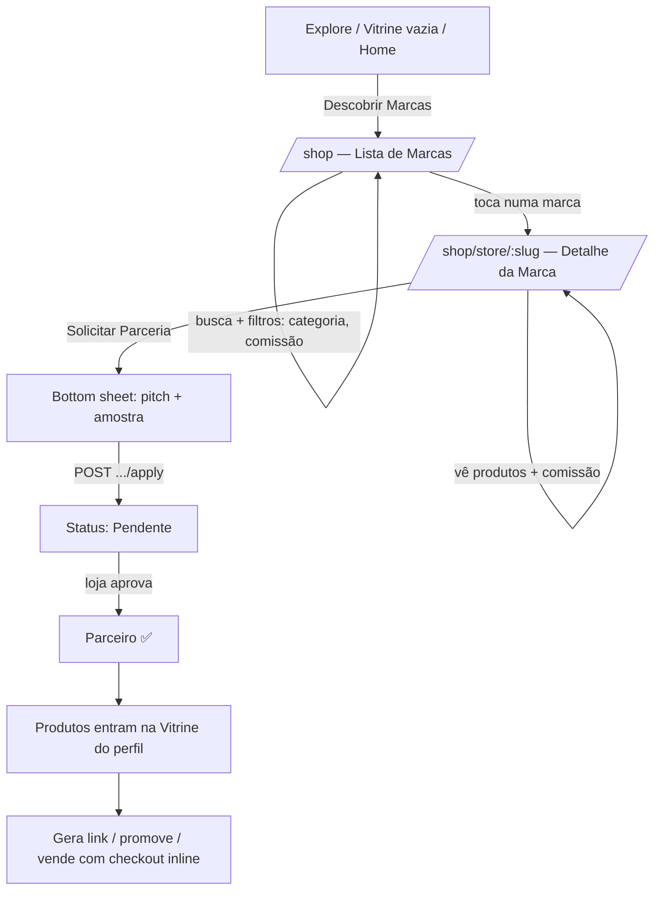
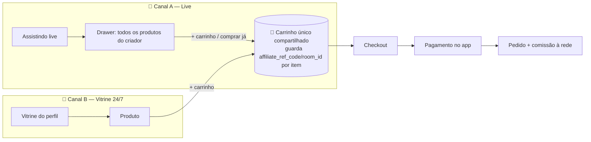

# 🛍️ Vitrine de Parceiros — Plano de Implementação (App)

> **Objetivo**: transformar a aba "Vitrine" do perfil (hoje só um grid vazio) num
> módulo completo de e-commerce social no app: o usuário navega marcas/lojas,
> **solicita** parceria, a marca **aprova**, e a vitrine do parceiro passa a
> exibir os produtos que ele promove — com **checkout inteligente** e
> **pagamento sem sair do app**.
>
> Modelo de negócio: **TikTok Shop** (parceiro ↔ loja).
>
> ## ⚠️ São DOIS módulos de desenvolvimento separados — ordem de execução:
>
> | Módulo | O quê | Quando |
> |---|---|---|
> | **A — Vitrine** (este documento) | Descobrir marcas, solicitar parceria, ver a
> vitrine de produtos de um parceiro no perfil, comprar pela vitrine (24/7, com
> o criador online ou não) | 🥇 **Começar por aqui** |
> | **B — Itens pinados em Live** | Produto pinado/drawer "Loja ao vivo" dentro
> da transmissão, compra sem sair da live | 🥈 **Depois** — evolução do Canal A
> descrito em §3.6; reaproveita o carrinho/checkout do Módulo A |
>
> Os dois módulos compartilham o **mesmo backend, carrinho e checkout** — por
> isso o Módulo A vem primeiro: ele constrói a fundação (marcas, parceria,
> produtos, carrinho, checkout, pagamento) que o Módulo B só vai **reaproveitar**
> dentro do player de live.
>
> ## 🎯 MVP inicial (Módulo A) — público e critério de pronto
>
> O primeiro incremento vendável **não** exige a tela "Descobrir Marcas" completa
> nem o fluxo de aprovação pronto no app. Ele serve o caso de uso mais simples e
> mais próximo do usuário real:
>
> 1. Usuário **cria conta** no app.
> 2. Usuário **segue** criadores que **já são parceiros aprovados** de alguma
>    marca (aprovação pode ter sido feita direto no backend/web enquanto o app
>    não tem essa UI ainda).
> 3. Ao visitar o **perfil** desses criadores, a aba **"Vitrine"** mostra os
>    produtos reais que eles promovem, e o usuário **compra pela vitrine**.
>
> → Isso é a Fase 1 (Vitrine do perfil) + Fase 3 (carrinho/checkout) + Fase 4
> (pagamento), **sem depender** da Fase 2 (apply/aprovar) estar pronta no app —
> o pipeline de aprovação pode continuar rodando na web/backend no início.
>
> **Filosofia de vendas — dois canais, um carrinho** (Módulo A entrega o canal 1;
> Módulo B entrega o canal 2 depois):
> 1. **Na vitrine (a qualquer hora):** as pessoas compram visitando a vitrine do
>    criador mesmo com ele offline — *"enquanto o criador dorme, sua rede vende"*.
> 2. **Ao vivo (live, Módulo B):** o espectador vê **todos** os produtos do
>    criador/parceiro num painel sobreposto e **adiciona ao carrinho sem sair da
>    live** — reaproveita o mesmo carrinho do Módulo A.
>
> Data: 2026-07-10 · Autor: engenharia Brawe · **Última atualização: 2026-07-11**
> · Status: **Em execução** — Fase 0 completa, Fase 1A completa (1A.1 vitrine
> do perfil + 1A.2 detalhe do produto), Fase 1B parcial (detalhe da marca
> pronto, descobrir marcas pendente), Fase 3 parcial (carrinho ✅, checkout
> ⚠️ não agrupa por loja ainda), Fase 4 mock (pagamento sem gateway real),
> Fase 5 e Fase 2 não iniciadas, Módulo B não iniciado. Ver §0.1 para detalhe
> completo por item e §9 para o que falta.

---

## ⚠️ Regra de terminologia — vale para TODO o módulo (leia antes de tudo)

> **A UI (telas, botões, mensagens, notificações, i18n) NUNCA usa a palavra
> "afiliado"/"affiliate". Usa sempre "Parceiro" / "Parceria".**
>
> `affiliate` continua existindo **somente na estrutura interna**: nomes de
> classes/models Dart, rotas de API (`/marketplace/affiliate/...`), nomes de
> arquivos de service/repository, chaves internas de JSON. **Nenhuma string
> visível ao usuário** (incluindo `.arb`, `Text()`, `SnackBar`, notificações push,
> nomes de tela no analytics) pode conter "afiliado"/"affiliate".
>
> Exemplos:
> - ✅ Classe `AffiliateApplication` (interno) → tela mostra **"Parceria"** / "Solicitação de parceria".
> - ✅ Rota `/marketplace/affiliate/showcase` (interno) → título da tela: **"Descobrir Marcas"**.
> - ✅ Service `store_showcase_service.dart` (interno, ok manter nome técnico).
> - ❌ Nunca: "Programa de Afiliados", "Seja um afiliado", "Status da afiliação".
> - ✅ Sempre: "Seja parceiro de marcas", "Minhas parcerias", "Parceiro aprovado".

---

## 0. TL;DR — Estado atual

| Camada | Situação |
|---|---|
| **Backend** (main + connect) | ✅ **~97% pronto**. Fluxo parceria→aprovação, marketplace, carrinho (com preview de comissão), pedidos, comissões e pagamentos (Wolknow PIX/cripto + IAP para coins) — tudo já existe. Gap do `CartItem` sem atribuição/comissão (§3.7 P4) foi **corrigido e aplicado em produção** (migrations 021 + 022). |
| **App Flutter — Módulo A (Vitrine)** | ✅ **Fundação + MVP de compra funcionando**. Fase 0 completa, Fase 1A completa (vitrine do perfil + detalhe do produto), Fase 1B parcial (detalhe da marca ✅, descobrir marcas ❌), carrinho ✅, checkout ⚠️ (funciona mas não agrupa por loja), pagamento ⚠️ (mock, sem gateway real). Fluxo navegável hoje: perfil → vitrine → produto → loja → carrinho → checkout → "pagamento" (mock). |
| **App Flutter — Módulo B (Live pinned)** | ❌ Não iniciado. `PinnedProductBar` + `ProductsDrawer` continuam só exibindo, sem carrinho/checkout. Depende do Módulo A completo. |

**Conclusão**: a fundação de dados/rede e o caminho de compra "feliz" (vitrine
→ produto → carrinho → checkout) já existem e compilam sem erros. **Falta**
para 100%: página `/shop` (descobrir marcas), `/shop/orders`, `/shop/partnerships`,
checkout multi-loja, gateway de pagamento real (Wolknow), Fase 2 (apply/aprovar
no app) e todo o Módulo B. Ver §0.1 (detalhe por item) e §9 (plano do que falta).

**MVP da capa (re-avaliado em 2026-07-11): ✅ atingido no nível "navegável".**
Usuário segue um parceiro aprovado (via backend/web) → visita o perfil → vê a
vitrine com produtos reais → abre o produto → adiciona ao carrinho → revisa no
carrinho (sem comissão exposta) → preenche checkout → chega numa tela de
pagamento. **O que falta para ser um MVP *vendável* de verdade**: o pagamento
ainda é mock (não cobra ninguém) e o checkout não separa por loja quando o
carrinho tem itens de lojas diferentes.

### 0.1 Status detalhado por tarefa (2026-07-11)

> Legenda: ✅ feito e validado · ⚠️ feito parcial/mock · ❌ não iniciado

| Item | Status | Nota |
|---|---|---|
| Fase 0 — Fundação (models/services/providers/rotas) | ✅ | `dart analyze` clean, 827 linhas |
| Backend P1 — `affiliate_id`/`affiliate_commission` no pedido | ✅ | Já existia, validado por investigação |
| Backend P3 — `GET /marketplace/affiliate/showcase` | ✅ | Já existia |
| Backend P4 — atribuição (`affiliate_ref_code`/`room_id`) em `CartItem`/`OrderItem` | ✅ | Migration 021, PR revisada (9.3/10) e mergeada, aplicada em produção |
| Backend (gap novo) — preview `comissao_rate`/`comissao_amount` em `cart_items` | ✅ | Migration 022, aplicada em produção; **não exibido na UI** (decisão de negócio 2026-07-11) |
| Fase 1A.1 — Vitrine do perfil | ✅ | `myStorefrontProductsProvider`, aba usa `S.of(context).profileTabShop` (i18n corrigido) |
| Fase 1A.2 — Detalhe do Produto | ✅ | `ShopProductPage` + 3 sub-widgets; comissão **removida** do `ProductStoreCard` |
| Fase 1B — Descobrir Marcas (`/shop`) | ❌ | Rota ainda `Placeholder()` — não iniciado |
| Fase 1B — Detalhe da Marca (`/shop/store/:slug`) | ✅ | `ShopStorePage` (878 linhas): banner, header, contatos sociais (url_launcher real), grid de produtos |
| Fase 1B — Pontos de entrada (Explore/Home → `/shop`) | ❌ | Não iniciado |
| Fase 2 — Solicitar/aprovar parceria no app | ❌ | Adiável — segue via backend/web como planejado |
| Fase 3 — Carrinho compartilhado | ✅ | `ShopCartPage` + `CartNotifier` (Riverpod `Notifier`, não `StateNotifier` — API mudou no Riverpod 3.x) |
| Fase 3 — Atribuição por item na origem | ✅ (backend) / ⚠️ (app) | Backend aceita `room_id`/`ref_code`; app ainda não tem UI de live para preencher `room_id` de verdade |
| Fase 3 — Badge global do carrinho | ⚠️ | Só no AppBar do `ShopProductPage`; falta em `ShopStorePage`/outras |
| Fase 3 — Checkout | ⚠️ | `ShopCheckoutPage` (716 linhas) funciona mas envia **1 `CheckoutRequest` único** mesmo com itens de lojas diferentes — falta agrupar por `storeId` e criar N pedidos |
| Fase 3 — Guards de estoque/erros (409) | ❌ | Só erro genérico via SnackBar |
| Fase 4 — Seleção de método + PIX/cripto/cartão | ⚠️ | `ShopPaymentPage` é mock (QR placeholder, sem gateway real) |
| Fase 4 — Polling de status de pagamento | ❌ | `paymentStatusProvider` existe, não é consumido ainda |
| Fase 4 — Tela de sucesso | ⚠️ | Botão "Ver Meus Pedidos" existe, mas leva a rota `Placeholder()` |
| Fase 5 — Meus Pedidos (`/shop/orders`) | ❌ | Rota `Placeholder()` |
| Fase 5 — Ganhos do parceiro | ❌ | Não iniciado |
| Fase 5 — Gerar link de parceria | ❌ | Não iniciado |
| Fase 5 — Lado lojista (Solicitações Recebidas) | ❌ | Adiável — existe na web |
| Fase 5 — Auditoria final 2 temas × 3 idiomas | ❌ | Telas criadas já nascem com i18n/tema, mas falta auditoria formal de todas as combinações |
| Módulo B — Itens pinados em live | ❌ | Não iniciado, depende do Módulo A completo |

---

## 1. Terminologia (UX) — DECIDIDO ✅

Nomenclatura visível ao usuário — **fechada** (ver regra no topo do documento).
Alinhada a plataformas (TikTok Shop, Instagram):

- **"Parceiro"** / **"Parceria"** para o usuário final (nunca "afiliado" na UI).
- **"Marca"** / **"Loja"** para o lojista.
- **"Solicitar parceria"** (não "aplicar").
- **"Minhas parcerias"** para o parceiro ver status.
- **"Solicitações recebidas"** para o dono da loja.
- **"Descobrir Marcas"** (título de tela; rota interna continua `/marketplace/affiliate/...`).

> `affiliate` é **só** termo técnico interno (classes, rotas, nomes de arquivo).
> Toda string em `.arb`/UI usa "Parceiro"/"Parceria"/"Marca". Ver checklist de
> i18n na Fase 1 para garantir que nenhuma chave nova traga "affiliate"/"afiliado"
> no valor visível (o **nome da chave** pode, o **texto** não).

---

## 2. Arquitetura de backend (o que reutilizar)

Dois backends compartilham **o mesmo PostgreSQL**. O marketplace é *single source
of truth* no **main backend** (`app.brawe.io`). O **connect** (`connect.brawe.io`)
faz checkout inline e lê os mesmos dados.

### 2.1 Rotas — Main backend (`AppDio` → `appApiV1Url`)

**Vitrine de lojas + parceria (TikTok Shop):**
`app/api/v1/endpoints/marketplace/store_showcase.py` (prefixo `/marketplace/affiliate`)

| Método + Rota | Uso |
|---|---|
| `GET /marketplace/affiliate/showcase` | Listar marcas/lojas (com filtros + `application_status` do usuário) |
| `GET /marketplace/affiliate/showcase/{store_slug}` | Detalhe da loja + top produtos + status da parceria |
| `POST /marketplace/affiliate/showcase/{store_slug}/apply` | **Solicitar parceria** (pitch + amostras opcionais) |
| `GET /marketplace/affiliate/my-applications` | **Minhas parcerias** (status) |
| `DELETE /marketplace/affiliate/my-applications/{id}` | Cancelar solicitação |
| `POST /marketplace/affiliate/my-applications/{id}/request-sample` | Pedir amostra pós-aprovação |
| `GET /marketplace/affiliate/applications/received` | **(Dono da loja)** solicitações recebidas |
| `PUT /marketplace/affiliate/applications/{id}/review` | **(Dono da loja)** aprovar/rejeitar (+ comissão custom) |
| `GET /marketplace/affiliate/approved-stores/{store_id}/products` | Produtos de loja onde o afiliado foi aprovado |
| `POST /marketplace/affiliate/approved-stores/{store_id}/generate-link` | Gerar link de rastreio do produto |

**Produtos / Loja / Pedidos / Pagamento (físico):**
- `marketplace/products.py` — `GET /marketplace/products`, `GET /marketplace/products/public/{id}` etc.
- `marketplace/cart.py` — carrinho completo (`/marketplace/cart`)
- `marketplace/orders.py` — `POST /marketplace/orders`, `POST .../{id}/initiate-payment?payment_method=pix|btc|eth|usdt_trc20`, `GET .../{id}/payment-status`

### 2.2 Rotas — Connect backend (`LiveDio` → `connectApiV1Url`)

**Checkout inline (comprar sem sair do app):** `app/api/v1/shopping.py`

| Método + Rota | Uso |
|---|---|
| `GET /shopping/payment-config` | Métodos de pagamento habilitados |
| `GET /shopping/stores` · `GET /shopping/stores/{id_or_slug}` · `GET /shopping/stores/{id}/products` | Loja (read-only) |
| `POST /shopping/checkout` | **Cria pedido** (decrementa estoque com lock, calcula split de comissão) |
| `POST /shopping/payments/create` | Cria pagamento Wolknow (PIX/cripto) |
| `GET /shopping/payments/{payment_id}/status` | Polling do status do pagamento |
| `GET /shopping/orders` · `GET /shopping/seller/orders` | Pedidos do comprador / vendedor |

**Schema do checkout** (`app/schemas/shopping.py::CheckoutRequest`):
```py
product_id: str
quantity: int = 1  (1..99)
shipping_address_id: Optional[str]   # ou endereço inline
room_id: Optional[str]               # se veio de uma live
affiliate_ref_code: Optional[str]    # atribuição de comissão
```

### 2.3 Modelos-chave (referência de campos p/ os DTOs Dart)

- `Store` (`stores`): `id, name, slug, logo_url, banner_url, currency,`
  `default_affiliate_commission, status, accept_pix, accept_credit_card,`
  `accept_crypto, accept_brawe_credits, total_products, rating`.
- `Product` (`products`): `id, store_id, name, slug, price, compare_at_price,`
  `affiliate_commission, sku, quantity(stock), images(JSONB), is_digital, status, total_sold`.
- `AffiliateApplication` (`affiliate_applications`): `affiliate_id, store_id,`
  `status(pending|approved|rejected|cancelled), message, custom_commission,`
  `sample_requested, reviewed_at`. Unique `(affiliate_id, store_id)`.
- `MarketplaceOrder` (`marketplace_orders`): split `platform_fee /`
  `affiliate_commission / store_revenue`, `source(marketplace|connect|live)`,
  `affiliate_id`, endereços JSONB, `payment_method`, status enums.

### 2.4 Política de pagamento (Apple/Google) — DECIDIDO ✅

| Tipo de item | Rail de pagamento | Motivo |
|---|---|---|
| **Bens físicos** (produtos da vitrine) | **Wolknow** (PIX / cripto) | Bens físicos são isentos de IAP nas lojas |
| **Coins / digital** | **IAP** (Apple/Google) | Obrigatório para conteúdo digital consumido no app |

> A vitrine de produtos físicos usa **Wolknow**, não IAP. Reaproveitar o padrão de
> `iap_service.dart` **apenas** para coins.

---

## 2.5 Requisitos transversais OBRIGATÓRIOS (todas as telas) ⚠️

Estes requisitos valem para **todas** as telas/widgets do módulo, em **todas as
fases** — são critério de aceite (Definition of Done) de cada PR.

### 🎨 Dois temas (claro + escuro) — obrigatório

- **Proibido** usar cores hardcoded (`Colors.white`, `Colors.black`, `Color(0x..)`
  fixos). Usar **sempre** o sistema de tema do projeto: `context.colors.*`
  (extensão `BraweColorsContext` em `lib/ui/core/themes/brawe_colors.dart`).
- Paleta disponível: `background, surface, surfaceElevated, surfaceHighest,`
  `textPrimary, textSecondary, textTertiary, textOnAccent, border, divider,`
  `accentPrimary, accentSecondary, accentPink, accentGold, success, warning, danger`.
- Cor de marca fixa permitida só para acento: `AppColors.electricPurple`
  (= `context.colors.accentPrimary`).
- **Testar cada tela nos 2 temas** antes de mergear. Atenção a: textos de tabs,
  QR code do PIX (fundo deve garantir contraste), badges de status, empty/error
  states, imagens/scrims.
- Lição aprendida (bug recente da Vitrine): headers persistentes
  (`SliverPersistentHeaderDelegate`) devem retornar `shouldRebuild = true` quando
  o conteúdo/tema muda, senão a cor "trava" no tema anterior.

### 🌐 Três idiomas (pt, en, es) — obrigatório

- **Proibido** texto literal na UI. Toda string vem do i18n:
  `S.of(context).<chave>` (arquivos `lib/l10n/app_pt.arb`, `app_en.arb`,
  `app_es.arb`; gerados em `lib/gen/l10n/`).
- Ao criar uma tela, **adicionar as 3 traduções** (pt/en/es) na mesma PR e rodar
  o gerador de l10n.
- Cuidar de: pluralização (ex.: "1 produto" / "2 produtos"), formatação de
  **moeda** (respeitar `currency` da loja) e de **datas** conforme o locale.
- Paridade de chaves com o web: o frontend já tem `storeShowcase` em
  `frontend/locales/{en,pt,es}.json` — reaproveitar nomenclatura quando fizer sentido.
- Termos de UI seguem a seção 1 (ex.: "Parceiro"/"Partner"/"Socio" — validar
  a tradução com o time; sugestão es: "Socio"/"Colaborador").

> **DoD de cada tela**: renderiza correto em (claro/escuro) × (pt/en/es) = 6
> combinações, sem overflow, sem cor hardcoded, sem string literal.

---

## 3. Único ajuste de backend necessário (opcional Fase 1)

**Endpoint de agregação da vitrine do parceiro** — hoje a "vitrine de um parceiro"
é *implícita* (produtos de todas as lojas onde ele foi aprovado). Para a aba
"Vitrine" do perfil de um usuário, criar:

```
GET /marketplace/affiliate/{user_id}/storefront?page=1&limit=20
→ { success, data: [ ProductCard { id, name, slug, price, compare_at_price,
     image, store: {id, slug, name, logo}, affiliate_commission } ], total }
```
Agrega `products` de todas as `affiliate_applications` com `status='approved'` do
`user_id`. Enquanto não existir, a Fase 1 pode usar
`GET /marketplace/affiliate/approved-stores/{store_id}/products` por loja.

---

## 3.5 Onde o parceiro DESCOBRE as marcas no app 🔎

> Pergunta-chave: *"se um usuário quer se inscrever para ser parceiro de uma
> marca, onde ele vai descobrir essa marca no app?"*

**Estado atual da navegação** (`lib/routing/router.dart` → `ShellRoute` +
`HomeBottomNav`):
- Bottom nav com **4 destinos** + botão central "+": **Início** (`/home`),
  **Feed** (`/feed`), **+** (criar), **Chat** (`/chat`), **Perfil** (`/profile/:id`).
- A barra já está cheia — **não há espaço** para uma 5ª aba sem redesenhar.
- Já existe uma tela **`/explore`** (busca/descoberta de lives e streamers),
  acessível pela lupa do Feed (`feed_screen.dart` → `context.push('/explore')`).

### Pontos de entrada recomendados (descoberta de marcas)

Como a bottom nav está cheia, a descoberta de marcas (`/shop`) entra por
**múltiplos pontos de acesso**, sem criar nova aba:

1. **Aba "Explore/Descobrir"** (principal): adicionar uma seção/segmento
   **"Marcas"** dentro da tela `/explore` existente (ao lado de Lives/Criadores),
   ou um sub-tab "Marcas" no topo. → abre `/shop`.
2. **CTA na Vitrine do perfil** (já existe o gancho): o estado vazio
   `_EmptyStorefront` hoje leva a `/creator/intro`. Trocar/duplicar o CTA para
   **"Descobrir marcas para promover"** → `/shop`. Este é o caminho natural de
   quem quer virar parceiro.
3. **Banner/atalho na Home** (`/home`): um card "Seja parceiro de marcas" na
   seção de descoberta da home.
4. **Deep link / durante a live**: ao ver um produto pinado numa live, o usuário
   pode tocar em "Ver loja" → detalhe da marca → **solicitar parceria**.

### Fluxo de descoberta → parceria (jornada do parceiro)



> **Resumo**: o parceiro descobre marcas em **`/shop`** ("Descobrir Marcas"),
> alcançável pelo **Explore**, pelo **CTA da Vitrine** e por **atalho na Home**.
> A tela de detalhe da marca é onde ele **solicita a parceria**.

---

## 3.6 Dois canais de venda + carrinho compartilhado 🛒 (DECISÃO DE ESCOPO)

> **Decisão**: o **carrinho NÃO é opcional** — é peça central. As vendas acontecem
> em **dois canais** que compartilham **o mesmo carrinho**, para o comprador poder
> juntar vários itens (da live e/ou da vitrine) e pagar de uma vez.

### Canal A — Compra AO VIVO (sem sair da live) 🔴

O espectador continua assistindo enquanto compra:

- **"Loja ao vivo"** (drawer sobreposto — já existe `products_drawer.dart` +
  string `productsDrawerTitle`): ao tocar no ícone da sacola / produto pinado,
  abre um `DraggableScrollableSheet` com **TODOS os produtos** do criador/parceiro
  (não só o pinado). A live continua tocando atrás.
- Em cada produto: **"Adicionar ao carrinho"** (+ quantidade) e/ou **"Comprar já"**.
- **Badge do carrinho** visível na overlay da live (contador de itens).
- A compra herda automaticamente **`room_id`** + **`affiliate_ref_code`** para a
  **atribuição de comissão** ao criador daquela live.
- O comprador pode adicionar **vários** produtos e continuar assistindo; finaliza
  quando quiser (durante ou após a live).

> Base já existente: `PinnedProductBar` (produto pinado) e `ProductsDrawer`
> ("Loja ao vivo") — hoje só exibem. Evoluir para **carrinho + checkout inline**.

### Canal B — Compra pela VITRINE (a qualquer hora) 🌙

- A **vitrine do perfil** do criador/parceiro fica sempre disponível (mesmo
  offline). Qualquer visitante navega os produtos e compra.
- Mesma jornada de carrinho → checkout → pagamento, com `affiliate_ref_code` do
  dono da vitrine (a rede vende 24/7).

### Carrinho compartilhado (regra)

- **Um único carrinho por usuário** (backend `marketplace/cart.py`), acessível da
  live, da vitrine e de qualquer produto.
- Itens de **lojas diferentes** agrupados por loja no carrinho (o backend já
  modela `Cart`/`CartItem` e o pedido é por loja).
- A **atribuição de comissão** é fixada **por item** no momento em que ele entra
  no carrinho (guardar `affiliate_ref_code`/`room_id` de origem), para que um item
  adicionado numa live credite aquele criador mesmo que o checkout ocorra depois.
- Badge global de carrinho (contador) visível na vitrine, na live e no `/shop`.



> **Impacto no escopo**: o carrinho **entra no MVP** (não é mais "opcional").
> Isso adiciona ~3-4 dias mas é essencial ao modelo de negócio.

---

## 3.7 Decisões técnicas pré-implementação (5 pontos a fechar) 🔒

> Resultado do diagnóstico do backend **real** (não suposição). Estes 5 pontos
> precisam estar decididos **antes** de escrever código, pois afetam contratos.

### Ponto 1 — Contrato de checkout MULTI-ITEM 🔴 (decisão necessária)

**Achado**: existem **dois** caminhos de checkout, com capacidades diferentes:
- **Connect** `POST /shopping/checkout` (`shopping.py`): **single-item** —
  aceita `product_id` + `quantity`. Grava **1 pedido = 1 produto**. É o caminho
  "inline" atual. **Não** aceita lista de itens.
- **Main** `POST /marketplace/orders` (`orders.py` → `OrderService.create_order`):
  **multi-item de verdade** — cria o pedido **a partir do `Cart`** (todos os itens
  do carrinho), agrupando por loja. É o checkout completo.

**Decisão recomendada**: para o carrinho compartilhado (§3.6), o checkout do app
usa **o caminho do MAIN** (`POST /marketplace/orders` a partir do `Cart`), que já
é multi-item e multi-loja. O `POST /shopping/checkout` do Connect fica só para
**"Comprar já" de 1 item** (atalho na live). → **Dois botões, dois caminhos:**
- "Comprar já" (1 produto) → Connect `/shopping/checkout`.
- "Finalizar carrinho" (N itens) → Main `/marketplace/orders`.

> ⚠️ **Ação backend**: confirmar o `OrderCreate` schema do main (campos aceitos) e
> se ele fecha pagamento pela mesma via Wolknow. Se o main dividir em 1 pedido por
> loja, o app deve lidar com **múltiplos pedidos** num checkout.

### Ponto 2 — Carrinho MULTI-LOJA ✅ (modelo pronto, regra a definir)

**Achado**: `Cart` + `CartItem` (main, `marketplace.py`) já suportam multi-loja —
`CartItem` tem `store_id`, `product_id`, `variant_id`, `quantity`, `unit_price`.

**Decisão**: o carrinho agrupa itens **por loja** na UI; o checkout do main gera
**1 pedido por loja** (cada loja tem seu split de comissão/frete). O app mostra o
resumo agrupado e trata o retorno como **lista de pedidos**.

> ⚠️ **Gap**: `CartItem` **NÃO tem** `affiliate_ref_code`/`room_id` (ver Ponto 4).

### Ponto 3 — Endpoint de produtos da live ✅ (existe, mas limitado)

**Achado**: `GET /shopping/live/{room_id}/products` **existe** e retorna os
produtos da live — porém só os **fixados/pinados** (`LiveProduct` com
`is_active`), não necessariamente **todos** os produtos do criador/parceiro.

**Decisão**: o Canal A (§3.6) quer mostrar **todos os produtos do criador**. Opções:
- **(a)** usar `GET /shopping/live/{room_id}/products` para os pinados **+**
  `GET /marketplace/affiliate/{user_id}/storefront` (o agregado novo, §3) para o
  catálogo completo do criador; ou
- **(b)** estender o endpoint da live para aceitar `?all=true` e retornar o
  storefront completo do streamer.

> **Recomendado (a)**: reusa o storefront agregado (que já precisamos criar) e
> evita mexer no endpoint da live. Pinados aparecem em destaque; resto abaixo.

### Ponto 4 — Atribuição e SNAPSHOT de comissão por item 🔴 (gap crítico)

**Achado** (o mais importante):
- `OrderItem` (main) **JÁ TEM** os campos `affiliate_commission_rate` e
  `affiliate_commission_amount` — ou seja, o **snapshot por item é suportado**.
- `MarketplaceOrder` tem `affiliate_id` + `affiliate_commission`.
- **PORÉM** o checkout do **Connect** (`/shopping/checkout`) **NÃO preenche**
  `affiliate_id` nem `affiliate_commission` no `marketplace_orders`/`order_items`
  — ele só guarda `affiliate_ref_code` numa tabela de referência leve
  (`connect_shopping_orders`). **A comissão do afiliado não está sendo persistida
  no pedido oficial.**
- `CartItem` **NÃO tem** campo de origem (`affiliate_ref_code`/`room_id`).

**Decisão / especificação**:
1. **Snapshot no momento de adicionar ao carrinho**: gravar por item a origem
   (`affiliate_ref_code`/`room_id`) e a **taxa de comissão vigente** (`product.affiliate_commission`
   → senão `store.default_affiliate_commission`). Isso "congela" a comissão mesmo
   que a loja mude a taxa depois.
2. **Persistir no pedido**: no checkout, preencher `OrderItem.affiliate_commission_rate`
   + `affiliate_commission_amount` e `MarketplaceOrder.affiliate_id` a partir do
   snapshot do item.
3. **Comissão diferida (live→depois)**: como a origem fica no item, o crédito ao
   criador acontece no checkout mesmo que a live já tenha terminado.

> ⚠️ **Ação backend (bloqueante)**: (a) adicionar `affiliate_ref_code`/`room_id`
> + comissão snapshot ao `CartItem`; (b) fazer o(s) checkout(s) preencherem
> `affiliate_id`/`affiliate_commission` no `marketplace_orders`/`order_items`.
> **Sem isso, a rede não é creditada** — é o core do modelo de negócio.

### Ponto 5 — Revisão da estimativa da Fase 3

Com os achados acima, a Fase 3 cresce (checkout multi-loja + correção de
atribuição no backend + integração live). **Nova estimativa: 6-8 dias** (era 5-6),
sendo **~1-2 dias de backend** (Pontos 1 e 4) além do app.

| Sub-item | Onde | Dias |
|---|---|---|
| Backend: `CartItem` origem+comissão snapshot; checkout preenche `affiliate_*` | 🔧 backend | 1-2 |
| App: carrinho multi-loja + badge | app | 2 |
| App: Canal A (live) — todos os produtos + add carrinho | app | 1.5 |
| App: checkout (main multi-item) + endereço + N pedidos | app | 1.5-2 |
| Guards/erros + QA | app | 1 |

> **Resumo dos bloqueantes de backend antes/junto da Fase 3**: Ponto 1 (confirmar
> `OrderCreate`), Ponto 3 (storefront agregado) e Ponto 4 (atribuição/snapshot).

---

## 4. Fases de implementação (app)

> Cada fase entrega valor incremental e é testável isolada. Estimativas em
> dias-dev (1 dev sênior Flutter).

### 🔹 FASE 0 — Fundação de dados e rede (2-3 dias)
**Objetivo**: modelos, serviços e roteamento base — sem UI ainda.

1. **DTOs / Models** (`lib/domain/models/` + `lib/data/model/` freezed):
   - `Store` (completo, não o raso atual)
   - `Product` (expandir: `slug, storeId, store, compareAtPrice, commission, sku, stock, images[], isDigital, totalSold`)
   - `PartnershipApplication` (nome da classe Dart; mapeia o `AffiliateApplication`
     interno do backend) — `id, storeId, status, message, customCommission, reviewedAt`
   - `Cart` / `CartItem`, `Order` / `OrderItem`, `ShippingAddress`
   - `PaymentIntent` (`paymentId, method, pixQrCode, cryptoAddress, expiresAt, status`)
   - Enums: `PartnershipStatus`, `OrderStatus`, `PaymentStatus`, `PaymentMethod`.
2. **Services** (Dio) — nomes de arquivo/classe podem usar `affiliate`
   internamente (mapeiam rotas `/marketplace/affiliate/...`), mas **nenhuma
   string retornada à UI** usa essa palavra:
   - `StoreShowcaseService` (main): showcase, detail, apply, my-applications, cancel.
   - `ProductService` (reescrever): produtos por loja / storefront do parceiro.
   - `CartService` (main), `CheckoutService` (connect: checkout + payments), `AddressService`.
3. **Repositories + Riverpod providers** (padrão do projeto).
4. **Rotas** (`lib/routing/`): registrar `/shop`, `/shop/store/:slug`,
   `/shop/product/:id`, `/shop/cart`, `/shop/checkout`, `/shop/orders`,
   `/shop/partnerships` (minhas parcerias), `/shop/partnerships/received` (lojista).
5. **Corrigir a chamada quebrada** `product_service.getUserProducts` → apontar
   para o endpoint real (storefront agregado ou por loja).

**Entregável**: `dart analyze` limpo; providers retornam dados reais dos endpoints.

---

### 🔹 FASE 1 — Vitrine do perfil (MVP 🎯) + Descoberta de marcas (3-4 dias)
**Objetivo**: entregar o MVP da capa primeiro (ver vitrine e comprar), depois a
descoberta completa. Dividida em **1A** (prioridade máxima) e **1B**.

> A partir daqui há UI: **cada tela nasce já com 2 temas + 3 idiomas** (ver §2.5).

**1A — MVP (fazer primeiro):**
1. **Vitrine do perfil** (aba "Vitrine"): substituir `_EmptyStorefront` broken —
   se o usuário (que o app já permite seguir) tem parcerias aprovadas no backend,
   mostrar produtos agregados reais; senão CTA **"Descubra marcas para
   promover"** (texto final, nunca "afiliado"). Consome o storefront agregado (§3).
2. **Tela de produto** (`/shop/product/:id`): galeria de imagens, preço, estoque,
   descrição, botão **"Comprar"**. (Comissão é interna — não exibir % ao comprador.)

**1B — Descoberta completa (pode vir depois do MVP, sem bloquear Fase 3/4):**
3. **Pontos de entrada para descoberta** (ver §3.5): adicionar segmento/sub-tab
   **"Marcas"** no `/explore`, CTA "Descobrir marcas" na Vitrine vazia do perfil,
   e atalho na Home. Todos abrem `/shop`.
4. **Tela "Descobrir Marcas"** (`/shop`): grid/lista de lojas com logo, banner,
   nº de produtos, rating. Busca + filtros (categoria).
5. **Detalhe da Marca** (`/shop/store/:slug`): banner, descrição, top produtos,
   status da parceria (badge: Sem parceria / Pendente / Parceiro).

**Entregável do MVP (1A)**: usuário segue um parceiro já aprovado (via backend/
web) e compra pela vitrine do perfil dele, sem precisar de mais nada.
**Entregável completo (1A+1B)**: usuário também descobre marcas por conta própria.

---

### 🔹 FASE 2 — Fluxo de Parceria (apply → aprovar) (3-4 dias) — ADIÁVEL no MVP
**Objetivo**: o coração do modelo TikTok Shop — mas **não bloqueia** o MVP da
Fase 1, pois o app pode continuar usando aprovações feitas via backend/web
enquanto essa UI não existe.

1. **Solicitar parceria** (bottom sheet no detalhe da marca): campo de pitch
   (`message`), opção de pedir amostra (`sample_requested` + produtos).
   → `POST /marketplace/affiliate/showcase/{slug}/apply` (interno).
2. **Minhas Parcerias** (`/shop/partnerships`): lista com status (pendente/
   aprovada/rejeitada), cancelar pendente, pedir amostra pós-aprovação.
3. **(Lojista) Solicitações Recebidas** (`/shop/partnerships/received`): lista de
   candidatos com métricas, aprovar/rejeitar com comissão custom →
   `PUT /marketplace/affiliate/applications/{id}/review` (interno).
4. **Estados/Badges** e notificações (reaproveitar push existente) — textos
   sempre "Parceria"/"Parceiro", nunca "afiliado".

**Entregável**: fluxo completo solicitar→aprovar dentro do app; após aprovação,
produtos da loja entram na vitrine do parceiro.

---

### 🔹 FASE 3 — Carrinho compartilhado + Checkout (6-8 dias) ⭐
**Objetivo**: comprar juntando vários itens (live + vitrine) sem sair do app.

> O **carrinho é central** (§3.6), não opcional. Compartilhado entre live e vitrine.
> **Inclui ~1-2 dias de backend** (Pontos 1 e 4 da §3.7): `CartItem` com origem +
> snapshot de comissão, e checkout preenchendo `affiliate_id`/`affiliate_commission`.

0. **Backend (bloqueante, §3.7 Pontos 1/4)**: adicionar origem+comissão snapshot ao
   `CartItem`; garantir que o checkout persista `affiliate_*` no pedido/itens;
   confirmar `OrderCreate` multi-item do main.

1. **Carrinho compartilhado** (`/shop/cart`): add/update/remove itens, cupom,
   resumo **por loja**, subtotal/frete/total (`marketplace/cart.py`). Guardar
   **`affiliate_ref_code`/`room_id` por item** na origem (atribuição de comissão).
2. **Badge global do carrinho** (contador de itens) visível na vitrine, na live e no `/shop`.
3. **Integração na LIVE (Canal A)** — evoluir `products_drawer.dart`:
   - Drawer "Loja ao vivo" lista **todos os produtos** do criador (não só o pinado).
   - Botões **"Adicionar ao carrinho"** (+ qty) e **"Comprar já"** por produto.
   - Live continua tocando atrás; herdar `room_id` + `affiliate_ref_code`.
4. **Endereço de entrega**: listar/criar (`shipping_address`); selecionar no checkout.
5. **Checkout inteligente** (`/shop/checkout`):
   - Resumo (agrupado por loja) + endereço + método de pagamento.
   - Propaga a atribuição de comissão fixada por item.
   - Criar pedido(s) → `POST /shopping/checkout` (connect, inline).
6. **Guard de estoque / erros** (produto esgotado, 409 lock, etc.).

**Entregável**: comprador junta itens da live e/ou da vitrine num carrinho único e
finaliza; pedido(s) em `marketplace_orders` com `source='connect'` e split de
comissão correto por item.

---

### 🔹 FASE 4 — Pagamento no app (Wolknow) (4-5 dias)
**Objetivo**: pagar sem sair do app (PIX / cripto).

1. **Seleção de método** a partir de `GET /shopping/payment-config` e das flags da
   loja (`accept_pix / accept_crypto`).
2. **Criar pagamento** → `POST /shopping/payments/create`.
3. **PIX**: exibir QR code + copia-e-cola + expiração; **Cripto**: endereço +
   valor + QR.
4. **Polling de status** → `GET /shopping/payments/{payment_id}/status` até
   `paid|failed|expired` (com timeout e retry). WebSocket/push como otimização.
5. **Tela de sucesso** + acompanhamento do pedido.

> ⚠️ **Não usar IAP** aqui (bens físicos). IAP fica só para coins.

**Entregável**: compra ponta-a-ponta com pagamento confirmado dentro do app.

---

### 🔹 FASE 5 — Pedidos, comissões e polimento (3-4 dias)
1. **Meus Pedidos** (`/shop/orders`) + rastreio (`GET /shopping/orders`).
2. **(Lojista) Pedidos recebidos** + atualizar status (enviar/entregar).
3. **Ganhos do parceiro**: comissões por venda (`marketplace/finance.py`,
   `affiliate/earnings.py` — interno) — integrar na tela de carteira/creator.
4. **Geração de link de parceria** (compartilhar produto) →
   `POST .../approved-stores/{store_id}/generate-link`.
5. **Auditoria final dos requisitos transversais (§2.5)**: varrer todas as telas
   nas 6 combinações (claro/escuro × pt/en/es), remover qualquer cor hardcoded ou
   string literal remanescente, revisar formatação de moeda/data por locale,
   empty/error/loading states, e testes de widget.

**Entregável**: módulo completo, localizado (pt/en/es), com 2 temas e polido.

---

## 5. Dependências / riscos

| Item | Nota |
|---|---|
| Endpoint de storefront agregado | Backend novo (pequeno) — Fase 1 pode contornar por-loja |
| Wolknow em produção | Confirmar credenciais/config no connect (`/shopping/payment-config`) |
| Atribuição de comissão | Garantir `affiliate_ref_code`/`room_id` propagados da vitrine/live até o checkout |
| Estoque concorrente | Backend já usa `FOR UPDATE`; app trata 409 |
| Políticas de loja (IAP) | Bens físicos via Wolknow ✅; nunca IAP para produtos |
| Paridade web | Espelhar contrato de `frontend/services/storeShowcase.ts` |
| **2 temas (claro/escuro)** | Obrigatório em todas as telas — só `context.colors.*` (§2.5) |
| **3 idiomas (pt/en/es)** | Obrigatório — só `S.of(context)`, 3 `.arb` por PR (§2.5) |
| **Ponto de entrada de descoberta** | Bottom nav cheia → usar Explore + CTA Vitrine + Home (§3.5) |

---

## 6. Checklist de endpoints a integrar (resumo)

- [ ] `GET /marketplace/affiliate/showcase` (marcas)
- [ ] `GET /marketplace/affiliate/showcase/{slug}` (detalhe)
- [ ] `POST /marketplace/affiliate/showcase/{slug}/apply` (parceria)
- [ ] `GET /marketplace/affiliate/my-applications`
- [ ] `DELETE /marketplace/affiliate/my-applications/{id}`
- [ ] `GET /marketplace/affiliate/applications/received` (lojista)
- [ ] `PUT /marketplace/affiliate/applications/{id}/review` (lojista)
- [ ] `GET /marketplace/affiliate/approved-stores/{store_id}/products`
- [ ] `POST /marketplace/affiliate/approved-stores/{store_id}/generate-link`
- [ ] `GET /shopping/stores`, `/shopping/stores/{id}/products`
- [ ] `POST /shopping/checkout`
- [ ] `GET /shopping/payment-config`
- [ ] `POST /shopping/payments/create`
- [ ] `GET /shopping/payments/{payment_id}/status`
- [ ] `GET /shopping/orders`, `GET /shopping/seller/orders`
- [ ] `GET /marketplace/cart` (+ add/update/remove/cupom) — **carrinho compartilhado (central)**
- [ ] `GET /shopping/live/{room_id}/products` — todos os produtos do criador na live (Canal A)
- [ ] **(novo)** `GET /marketplace/affiliate/{user_id}/storefront` — agregado

---

## 7. Estrutura de arquivos sugerida (app)

```
lib/
  domain/models/shop/
    store.dart  product.dart  partnership_application.dart  (interno: affiliate)
    cart.dart  order.dart  shipping_address.dart  payment_intent.dart
  data/
    services/shop/
      store_showcase_service.dart  product_service.dart
      cart_service.dart  checkout_service.dart  payment_service.dart
      address_service.dart
    repositories/shop/…
  ui/shop/
    view_models/…
    widgets/
      discover_stores_screen.dart   store_detail_screen.dart
      product_detail_screen.dart    partnership_apply_sheet.dart
      my_partnerships_screen.dart   received_applications_screen.dart
      cart_screen.dart              checkout_screen.dart
      payment_screen.dart           orders_screen.dart
  routing/  (registrar rotas /shop/**)
```

---

## 8. Estimativa total

| Fase | Módulo | Dias-dev |
|---|---|---|
| 0 — Fundação | A | 2-3 |
| 1A — **Vitrine do perfil (MVP 🎯)** | A | 1.5-2 |
| 1B — Descoberta de marcas completa | A | 1.5-2 |
| 2 — Parceria (solicitar/aprovar) — adiável no MVP | A | 3-4 |
| 3 — Carrinho compartilhado + Checkout **+ backend atribuição** | A | 6-8 |
| 4 — Pagamento (Wolknow) | A | 4-5 |
| 5 — Pedidos + comissões + polimento | A | 3-4 |
| **B — Itens pinados em Live** (evolui `ProductsDrawer`, reaproveita carrinho/checkout de A) | B | 3-4 (à parte) |
| **Total Módulo A** | | **~21-28 dias** (≈ 5-6 semanas, inclui ~1-2 dias de backend) |
| **Total Módulo B** (depois de A) | | **+3-4 dias** |

> **Caminho mais rápido até vender algo de verdade (MVP da capa)**:
> Fase 0 → **Fase 1A** (vitrine do perfil) → Fase 3 (carrinho/checkout) →
> Fase 4 (pagamento) = **~14-17 dias**. Fases 1B (descoberta) e 2 (apply/
> aprovar no app) rodam **em paralelo ou depois**, sem bloquear a venda —
> aprovações continuam via backend/web nesse meio-tempo. O lado lojista
> (Solicitações Recebidas, Fase 2 item 3) também fica para depois — já existe na web.

---

## 9. Status e próximos passos (atualizado 2026-07-11)

### 9.1 O que já foi resolvido ✅

1. ✅ **Terminologia fechada e aplicada**: UI sempre "Parceiro"/"Parceria";
   `affiliate` só interno. Validado via grep em todas as telas criadas.
2. ✅ **Comissão nunca exposta ao comprador**: decisão de negócio adicional
   (2026-07-11) — removida do `ProductStoreCard`/`ShopProductPage`. O campo
   `Store.defaultAffiliateCommission` e o preview `CartItem.comissao_*`
   continuam existindo no model/API para uso interno/backoffice, mas nenhuma
   tela de compra os renderiza.
3. ✅ **Ordem dos módulos fechada e em execução**: Módulo A em andamento,
   Módulo B não iniciado (correto, depende de A).
4. ✅ **5 pontos técnicos (§3.7) fechados**:
   - P1: `POST /marketplace/orders` (main) — já aceitava `affiliate_id`, validado.
   - P4: **backend implementado e em produção** — `CartItem`/`OrderItem` têm
     `affiliate_ref_code`/`room_id` (migration 021) + preview de comissão
     `comissao_rate`/`comissao_amount` em `cart_items` (migration 022).
   - P3 (parcial): storefront por loja funciona via `storeProductsProvider`
     (usa `GET` por `storeId`); o endpoint agregado dedicado (`/storefront`)
     **não foi criado** — a Fase 1A usa `getMyApplications()` + `getStoreProducts()`
     em paralelo no app (`myStorefrontProductsProvider`), suficiente para o MVP.
5. ✅ **Fase 0 completa**: models, services, repositories, providers, 8 rotas
   registradas no `GoRouter`.
6. ✅ **Fase 1A completa**: Vitrine do perfil + Detalhe do Produto navegáveis
   com dados reais.
7. ✅ **Fase 1B parcial**: Detalhe da Marca (`ShopStorePage`) completo.
8. ✅ **Fase 3 parcial**: Carrinho completo e funcional (`ShopCartPage` +
   `CartNotifier`).

### 9.2 O que falta para 100% (em ordem de prioridade sugerida)

**Bloqueante para "vender de verdade" (não apenas navegar):**
1. ❌ **Gateway de pagamento real (Wolknow)** — `ShopPaymentPage` hoje é mock
   (QR placeholder). Sem isso, nenhuma compra é processada de fato.
2. ⚠️ **Checkout multi-loja** — `ShopCheckoutPage` envia 1 `CheckoutRequest`
   único mesmo com itens de lojas diferentes no carrinho. Precisa agrupar
   `CartState.items` por `storeId` e chamar `checkout()` uma vez por grupo,
   criando N pedidos (conforme decisão original da Fase 3, item 3.6).
3. ❌ **`GET /marketplace/orders/:id`** — não existe no backend ainda;
   `ShopPaymentPage` não consegue buscar detalhes do pedido, só usa o `orderId`
   da rota. Necessário para a tela de sucesso/pedido mostrar dados reais.

**Telas com rota registrada mas ainda `Placeholder()`:**
4. ❌ `/shop` — Descobrir Marcas (grid de lojas, busca, filtros).
5. ❌ `/shop/orders` + `/shop/orders/:orderNumber` — Meus Pedidos + detalhe/rastreio.
6. ❌ `/shop/partnerships` + `/shop/partnerships/received` — Minhas Parcerias
   (lado parceiro) e Solicitações Recebidas (lado lojista, adiável).

**Fase 2 (adiável, mas necessária para fechar o ciclo sem depender da web):**
7. ❌ Solicitar parceria (bottom sheet no detalhe da marca).
8. ❌ Minhas Parcerias (lista + status + cancelar).
9. ❌ (Lojista) Solicitações Recebidas — aprovar/rejeitar com comissão custom.

**Polimento e qualidade:**
10. ⚠️ Badge global do carrinho — hoje só aparece no `ShopProductPage`; deveria
    estar visível em `ShopStorePage`, `/shop` e talvez na bottom nav principal.
11. ❌ Guards de estoque/erros específicos (409, esgotado) — hoje só SnackBar genérico.
12. ❌ Polling de status de pagamento (`paymentStatusProvider` existe, não é usado).
13. ❌ Auditoria formal das 6 combinações (2 temas × 3 idiomas) em todas as
    telas do módulo — feito organicamente tela a tela, mas nunca revisado como
    checklist único.
14. ❌ Persistência do `sessionId` anônimo do carrinho (hoje só em memória,
    perdido ao reiniciar o app).

**Módulo B (só depois de A estar 100%):**
15. ❌ Todo o Módulo B (itens pinados em live) — 6 tarefas (B.1-B.6), não iniciado.

### 9.3 Estimativa restante (dias-dev, 1 dev sênior Flutter)

| Bloco | Dias |
|---|---|
| Gateway de pagamento real (Wolknow) + polling | 3-4 |
| Checkout multi-loja + `GET orders/:id` (backend+app) | 1.5-2 |
| `/shop` Descobrir Marcas | 1.5-2 |
| `/shop/orders` + detalhe/rastreio | 1.5-2 |
| Fase 2 completa (parceria no app) | 3-4 |
| Polimento (badge, guards, auditoria, sessionId) | 1.5-2 |
| **Total até Módulo A 100%** | **~13-16 dias** |
| Módulo B (depois de A) | +3-4 |

> 📎 **Roadmap operacional** (rotas + fases + atribuição de agentes de IA por
> tarefa + padrão de UI moderna 2026 + status detalhado): ver
> **`VITRINE_ROADMAP_AGENTES.md`** (também atualizado em 2026-07-11).
